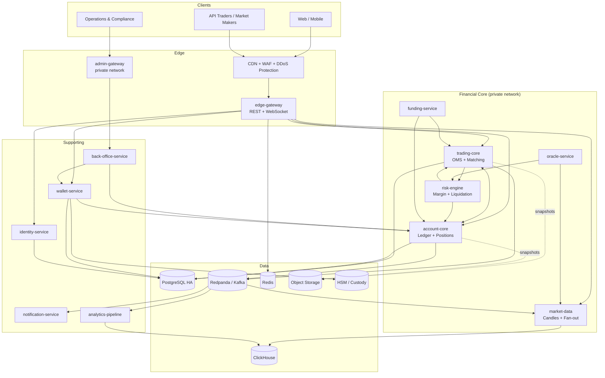
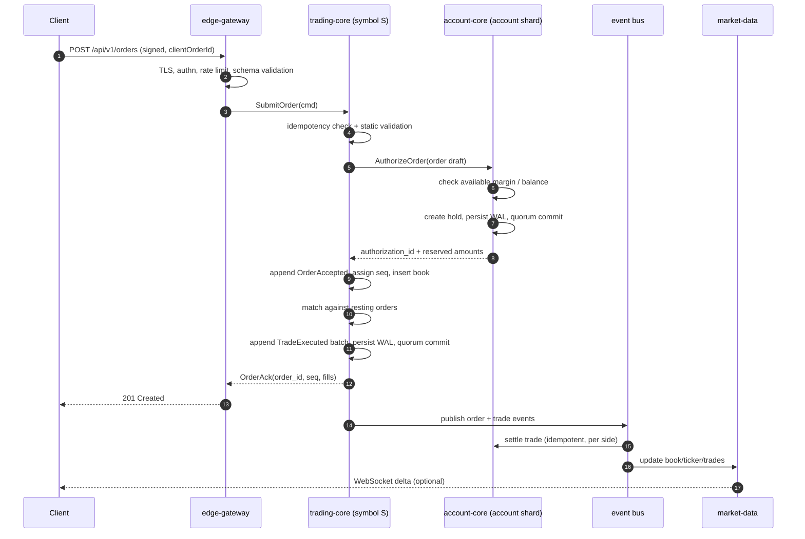
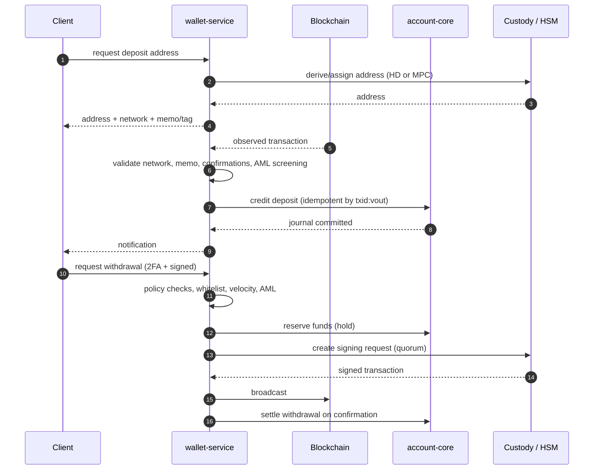
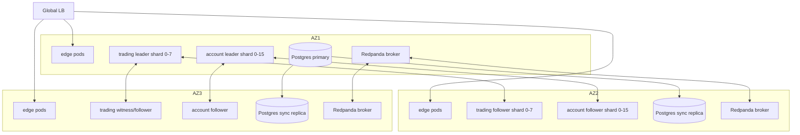

# 01 — System Architecture

---

## 1. Context

NEXORA exposes one public API surface to retail and institutional clients, and a
separate, network-isolated administrative surface to operations and compliance.
The backend is composed of stateless edge services and stateful, replicated
cores. Stateful cores are the only components allowed to mutate financial state.

### 1.1 System context



### 1.2 Trust boundaries

| Boundary | Controls |
|----------|----------|
| Internet → edge | TLS 1.3, WAF, DDoS scrubbing, rate limits, request signing |
| Edge → core | mTLS with SPIFFE identities, signed internal tokens, network policy |
| Core → data | mTLS, per-service DB roles, no shared credentials, audit logging |
| Core → custody | Dedicated HSM channel, mTLS, IP allowlist, quorum approval |
| Admin → back office | SSO + hardware MFA, bastion, break-glass with dual approval |
| Analytics → core | One-way event consumption; no write path |

---

## 2. Service inventory

| Service | Language | State | Scaling unit | Responsibility |
|---------|----------|-------|--------------|----------------|
| `edge-gateway` | Go | Stateless | Pod / connection | REST, WebSocket, authn/z enforcement, rate limiting, request validation, response caching |
| `identity-service` | Go | Postgres | Pod | Users, credentials, sessions, API keys, 2FA, KYC state, RBAC |
| `trading-core` | Rust | In-memory + WAL | Symbol shard | Order validation, OMS state, order book, matching, trade emission, market data publication |
| `account-core` | Rust | In-memory + WAL + Postgres journal | Account shard | Accounts, balances, holds, positions, margin state, settlement, funding application |
| `risk-engine` | Rust | Derived state | Account/symbol shard | Pre-trade margin checks, liquidation detection, ADL ranking, insurance fund policy |
| `market-data` | Rust | Stateless | Pod | Candles, tickers, trade history, order book snapshots, WebSocket fan-out |
| `oracle-service` | Rust | Stateless | Pod | Index price aggregation, mark price, staleness and deviation checks |
| `funding-service` | Rust | Job | Singleton per interval | Funding rate calculation and payment instruction |
| `wallet-service` | Rust | Postgres | Pod | Deposit addresses, chain watchers, withdrawal workflow, custody adapter |
| `back-office-service` | Go | Postgres | Pod | Admin workflows, case management, manual adjustments, reconciliation |
| `notification-service` | Go | Postgres | Pod | Email, SMS, push, webhooks, operational alerts |
| `analytics-pipeline` | Python/Go | ClickHouse | Pod | ETL, reporting, surveillance features, reconciliation reports |

### 2.1 Why the cores are separate

`trading-core` and `account-core` have different scaling and consistency
requirements:

- Trading is **per symbol**, CPU-bound, and latency-sensitive.
- Accounts are **per user**, I/O-bound on durable journal writes, and must
  survive independent shard failures.

Coupling them in one process would force one scaling dimension and one failure
domain for both. The interface between them is deliberately small: authorize,
release, settle, apply funding, liquidate.

---

## 3. Primary request flows

### 3.1 Order placement (happy path)



**Acknowledgement rule:** the client receives success only after the matching
core has durably committed the order and any resulting trades to a quorum. A
timeout is ambiguous; the client must query by `clientOrderId`. On commit, the
short authorization is bound to the order as a long-lived order hold; the bind
is idempotent and retried until it succeeds.

### 3.2 Cancel

1. Client sends `DELETE /api/v1/orders/{orderId}` or by `clientOrderId`.
2. Trading core validates ownership and state.
3. If resting: remove from book, append `OrderCanceled`, commit.
4. Publish `OrderCanceled`; account core releases the hold (idempotent by
   `order_id`).
5. If already filled or canceled, return the terminal state (idempotent 200).

### 3.3 Settlement

Trades are settled asynchronously but with bounded lag (target p99 < 250 ms).
Each trade produces **two independent settlement legs**, one per participant,
both against the system clearing account. This avoids cross-shard locks:

```
Buyer leg:   buyer base  +qty      clearing base  -qty
             buyer quote -cost     clearing quote +cost
             buyer fee   -fee      fee account    +fee

Seller leg:  seller base -qty      clearing base  +qty
             seller quote +proceeds clearing quote -proceeds
             seller fee  -fee      fee account    +fee
```

Each leg is a balanced journal batch. A leg is idempotent on
`(trade_id, participant_side)`. If one leg is delayed, the clearing account
carries a transient imbalance that is visible on dashboards and bounded by a
circuit breaker.

### 3.4 Deposit and withdrawal



---

## 4. Event backbone

### 4.1 Topics

| Topic | Key | Retention | Producers | Consumers |
|-------|-----|-----------|-----------|-----------|
| `trading.commands.v1` | symbol | 7 d | edge, risk | trading-core |
| `trading.events.v1` | symbol | 7 d | trading-core | settlement, market-data, risk, analytics |
| `account.commands.v1` | account_id | 7 d | trading-core, wallet, risk | account-core |
| `account.events.v1` | account_id | 30 d | account-core | risk, notification, analytics |
| `market.public.v1` | symbol | 1 d | trading-core | market-data, edge |
| `oracle.prices.v1` | symbol | 30 d | oracle-service | risk, funding, market-data |
| `funding.events.v1` | symbol | 30 d | funding-service | account-core, analytics |
| `wallet.events.v1` | account_id | 30 d | wallet-service | account-core, compliance |
| `ops.audit.v1` | account_id | 7 y (WORM) | all | audit sink, SIEM |

### 4.2 Delivery semantics

- At-least-once delivery with idempotent consumers.
- Per-key ordering guaranteed by partition key.
- Consumers persist `(topic, partition, offset)` in their inbox table in the
  same transaction as the effect.
- The transactional outbox is used whenever a database write and an event
  publish must be atomic.
- Schema registry with backward-compatible evolution; no field reuse.

### 4.3 Why not request/reply for settlement?

Settlement must survive consumer restarts and bursts. A durable log provides
replay, ordering per account, and backpressure. Synchronous settlement would
couple matching latency to ledger latency and create cascading failures.

---

## 5. Deployment topology

### 5.1 Primary region



- Edge pods are active in all three AZs behind a global load balancer.
- Each trading symbol belongs to exactly one **symbol shard** (Raft group of 3).
- Each account belongs to exactly one **account shard** (Raft group of 3).
- Stateful cores run on dedicated, CPU-pinned nodes with local NVMe for WAL.
- PostgreSQL uses Patroni with one synchronous and one asynchronous replica.
- Redpanda uses replication factor 3 with `acks=all` for financial topics.

### 5.2 Environments

| Environment | Purpose | Data |
|-------------|---------|------|
| `dev` | Local docker-compose | Synthetic |
| `staging` | Full topology, production-like | Synthetic + replay corpus |
| `perf` | Load and chaos testing | Synthetic at scale |
| `prod` | Customer traffic | Real |

Staging and perf run the same binaries and migrations as production. No
environment-specific code paths; configuration only.

### 5.3 Network segmentation

- Public ingress: only edge-gateway.
- Core network: no internet egress except oracle and chain watchers through a
  controlled proxy.
- Data network: database and bus ports reachable only from service identities.
- Admin network: separate ingress, SSO, hardware MFA, session recording.
- Custody network: dedicated VPC/VLAN, HSM, allowlisted signer hosts.

---

## 6. Data ownership

| Data | Owner | System of record | Projections |
|------|-------|------------------|-------------|
| Users, credentials | identity | Postgres `identity` | Redis session cache |
| Instruments, fees | back-office / config | Postgres `trading` | In-memory config in cores |
| Orders, trades | trading-core | WAL + Postgres `trading` | ClickHouse, market-data |
| Balances, holds | account-core | WAL + Postgres `ledger` | Risk cache, reporting |
| Positions, margin | account-core | Postgres `ledger` | Risk, back office |
| Funding rates | funding-service | Postgres `trading` | ClickHouse |
| Deposits, withdrawals | wallet-service | Postgres `wallet` | Analytics |
| Audit | all | WORM object storage | SIEM |

Each dataset has exactly one writer. Other services read via APIs or events.

---

## 7. Failure domains and degradation

| Component down | Impact | Mitigation |
|----------------|--------|------------|
| One edge pod | None | Load balancer removes it |
| Edge AZ | Increased latency | Other AZs absorb traffic |
| Trading follower | None | Leader continues; quorum still 2/3 |
| Trading leader | Symbol paused briefly | Raft election < 5 s; replay uncommitted |
| Account follower | None | Leader continues |
| Account leader | Orders for affected accounts fail | Election < 5 s; holds replayed |
| Kafka/Redpanda broker | No impact at RF=3 | Continue with remaining brokers |
| Kafka cluster | Settlement and market data lag | Outbox buffers; trading backpressures |
| Postgres primary | Writes to identity/wallet paused | Patroni failover < 60 s |
| ClickHouse | Analytics stale | No trading impact |
| Oracle | Mark price stale | Risk-increasing orders rejected; liquidation widens bands |
| Custody/HSM | Withdrawals paused | Trading unaffected |
| Redis | Rate limits degrade to conservative local buckets | No financial impact |

**Trading halt triggers:** ledger reconciliation failure, settlement lag beyond
threshold, oracle divergence beyond threshold, insurance fund below floor,
matching replay hash mismatch, or operator decision.

---

## 8. Extension points

- **New instrument type:** add an `InstrumentKind` and a matching policy; the
  order book and settlement interfaces remain unchanged.
- **New collateral asset:** ledger is multi-asset; risk adds a haircut table and
  conversion oracle.
- **New chain:** wallet-service plugin interface for watchers and signers.
- **New region:** replicate WAL archives and Postgres; promote via runbook.
- **Portfolio margin:** replace the margin calculator behind the
  `MarginModel` interface; account-core schema already stores per-position and
  per-account margin components.

---

## 9. Architecture invariants

1. No service other than `trading-core` writes order book state.
2. No service other than `account-core` writes balances, holds, or positions.
3. No financial mutation occurs without a WAL record and a balanced journal.
4. No client-visible success is returned before quorum commit.
5. No cross-shard database transaction exists.
6. Every event has a globally unique ID and a per-stream sequence.
7. Every service can be restarted without manual data repair.
8. Every deploy is backward compatible for at least one release.
