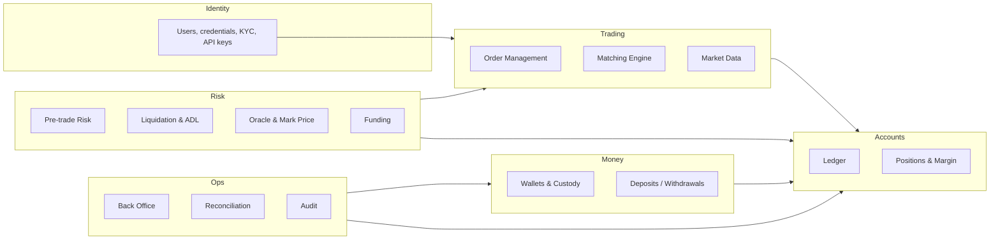
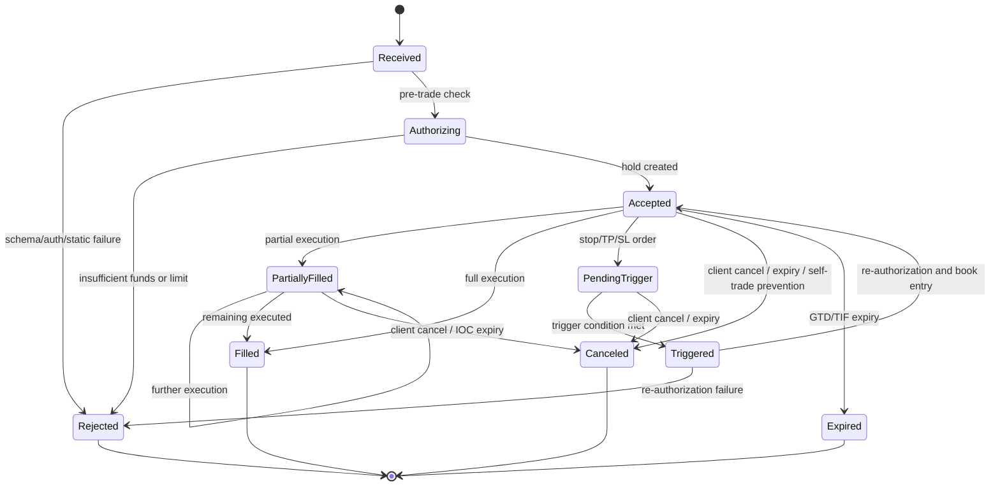
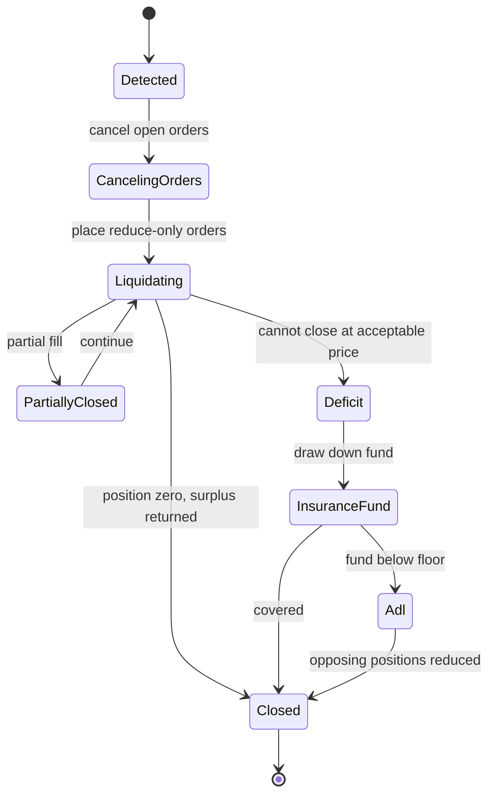

# 03 — Domain Model

---

## 1. Bounded contexts



| Context | Aggregate roots | Owns |
|---------|-----------------|------|
| Identity | `User`, `ApiKey`, `Session` | Credentials, roles, KYC status, permissions |
| Trading | `Instrument`, `Order`, `OrderBook`, `Trade` | Order lifecycle, matching, execution facts |
| Accounts | `Account`, `JournalBatch`, `Position`, `MarginAccount` | Balances, holds, journal, positions, margin |
| Risk | `RiskProfile`, `LiquidationCase`, `InsuranceFund` | Limits, margin decisions, liquidation workflow, fund accounting policy |
| Money | `Asset`, `Deposit`, `Withdrawal`, `CustodyWallet` | Chain observations, custody, transfer lifecycle |
| Ops | `ReconciliationRun`, `Case`, `Adjustment` | Operational workflows and evidence |

Each aggregate is mutated by exactly one service at a time. Cross-aggregate
consistency is achieved through events and sagas, never shared transactions.

---

## 2. Core value objects

### 2.1 Identifiers

| Type | Representation | Generation |
|------|----------------|------------|
| `AccountId` | UUIDv7 | On account creation |
| `UserId` | UUIDv7 | On registration |
| `OrderId` | `u64` | Per-symbol monotonic sequencer, encoded with shard prefix |
| `TradeId` | `u64` | Per-symbol monotonic sequencer |
| `FillId` | `(TradeId, FillIndex)` | Deterministic from trade |
| `JournalId` | UUIDv7 | On batch creation |
| `HoldId` | UUIDv7 | On reservation |
| `AuthorizationId` | UUIDv7 | On pre-trade authorization |
| `ClientOrderId` | string ≤ 36 chars | Client, unique per account |
| `PositionId` | `(AccountId, Symbol, PositionSide)` | Deterministic |

Order and trade IDs are numeric for compact wire format and operator
usability. They are unique within a symbol shard; the shard prefix makes them
globally unique if required for analytics.

### 2.2 Money types (normative)

```rust
pub struct AssetId(u32);
pub struct SymbolId(u32);

/// Price in integer ticks. tick_size is stored per instrument.
pub struct Price(i64);

/// Quantity in integer lots. lot_size is stored per instrument.
pub struct Qty(i64);

/// Signed amount in atomic units of an asset (e.g. micro-USDT).
pub struct Amount(i128);

/// Basis points, 1 bp = 0.01%. Used for fees, margin rates, funding.
pub struct Bps(i32);

/// Exact multiplier for contract value; stored as integer numerator/denominator.
pub struct Multiplier { num: i64, den: i64 }
```

Rules:

- `Price`, `Qty`, and `Amount` are never interchangeable; the compiler enforces
  distinct types.
- Conversion between lots and base quantity uses the instrument's exact
  `lot_size` rational.
- Conversion between ticks and quote value uses exact integer arithmetic with
  checked operations.
- No floating point on any path that can change a balance, position, fee, or
  margin value.

See [15-precision-atomicity-idempotency.md](15-precision-atomicity-idempotency.md)
for rounding and overflow rules.

### 2.3 Instrument

```rust
pub struct Instrument {
    pub symbol_id: SymbolId,
    pub symbol: String,              // "BTCUSDT"
    pub kind: InstrumentKind,        // Spot | Perpetual
    pub base: AssetId,
    pub quote: AssetId,
    pub tick_size: i64,              // quote units per tick
    pub lot_size: i64,               // base units per lot
    pub min_qty: Qty,
    pub max_qty: Qty,
    pub min_notional: Amount,
    pub max_notional: Amount,
    pub price_band_bps: i32,
    pub maker_fee_bps: Bps,
    pub taker_fee_bps: Bps,
    pub contract: Option<ContractSpec>,
    pub status: InstrumentStatus,    // Active | ReduceOnly | Halted | Delisted
}
```

`ContractSpec` for USDT-M:

```rust
pub struct ContractSpec {
    pub contract_size: Multiplier,   // base units per contract
    pub settlement_asset: AssetId,   // USDT
    pub max_leverage: u16,           // e.g. 125
    pub margin_tiers: Vec<MarginTier>,
    pub funding_interval_secs: u32,  // 28800
    pub funding_cap_bps: i32,
    pub liquidation_fee_bps: Bps,
    pub adl_enabled: bool,
}
```

### 2.4 Margin tier

| Field | Meaning |
|-------|---------|
| `notional_floor`, `notional_cap` | Bracket in USDT |
| `max_leverage` | Maximum leverage in this bracket |
| `mmr_bps` | Maintenance margin rate |
| `maintenance_amount` | Deduction that makes the maintenance function continuous across brackets |

Maintenance margin for notional `N` in bracket `i`:

```
MM(N) = N * mmr_i - maintenance_amount_i
```

Brackets are constructed so `MM` is continuous and non-decreasing at boundaries.
`maintenance_amount_i` is derived, not hand-entered.

### 2.5 Enumerations

```rust
pub enum Side { Buy, Sell }
pub enum PositionSide { Long, Short, Both }   // Both = one-way net row
pub enum NetSide { Long, Short, Flat }        // one-way direction
pub enum MarginMode { Cross, Isolated }
pub enum PositionMode { OneWay, Hedge }
pub enum OrderType { Limit, Market,
                     StopMarket, StopLimit, TakeProfit, TrailingStop,
                     ClosePosition }
pub enum TimeInForce { Gtc, Ioc, Fok, Gtd, Day }
pub enum OrderStatus { Received, Authorizing, Accepted, PendingTrigger,
                       Triggered, PartiallyFilled, Filled, Canceled,
                       Rejected, Expired }
pub enum HoldStatus { Active, Consumed, Released, Expired }
pub enum HoldPurpose { Order, Withdrawal, Fee, Liquidation, Funding }
```

A `Market` order implicitly uses IOC semantics. `IOC`, `FOK`, and `GTD` are
time-in-force values, while `PostOnly` and `ReduceOnly` are order flags.
`ClosePosition` resolves its quantity from the live position at execution time.

---

## 3. Trading aggregates

### 3.1 Order

```rust
pub struct Order {
    pub order_id: OrderId,
    pub account_id: AccountId,
    pub symbol_id: SymbolId,
    pub client_order_id: String,
    pub side: Side,                  // Buy | Sell
    pub order_type: OrderType,
    pub time_in_force: TimeInForce,
    pub price: Option<Price>,        // None for market
    pub stop_price: Option<Price>,
    pub qty: Qty,
    pub filled_qty: Qty,
    pub avg_fill_price: Option<Price>,
    pub remaining_qty: Qty,
    pub status: OrderStatus,
    pub position_side: PositionSide, // Both | Long | Short (hedge mode)
    pub reduce_only: bool,
    pub post_only: bool,
    pub close_position: bool,
    pub authorization_id: AuthorizationId,
    pub created_seq: u64,
    pub updated_seq: u64,
    pub created_at_ns: i64,
    pub expires_at_ns: Option<i64>,
    pub rejection_reason: Option<RejectReason>,
}
```

### 3.2 Order state machine



Terminal states: `Filled`, `Canceled`, `Rejected`, `Expired`.

Rules:

- An order in a terminal state never changes again.
- `filled_qty + remaining_qty = qty` always, except for `close_position` orders
  where quantity is resolved at trigger time.
- `avg_fill_price` is the quantity-weighted average of fills, rounded to tick.
- Every transition appends an immutable `OrderEvent` with a monotonically
  increasing `seq`.

### 3.3 Order types

| Type | Behavior |
|------|----------|
| `Limit` | Rest at price or better; may partially fill |
| `Market` | Execute against resting liquidity up to a slippage bound; remainder canceled |
| `Ioc` | Limit price, immediate execution, cancel remainder |
| `Fok` | Must fill entirely immediately or be canceled |
| `PostOnly` | Must rest; rejected if it would cross |
| `StopMarket` | Trigger on last/mark price, then market |
| `StopLimit` | Trigger on last/mark price, then limit |
| `TakeProfit` | Trigger when price moves favorably, then market/limit |
| `TrailingStop` | Trigger on a trailing distance from the extreme price |
| `ClosePosition` | Reduce-only market order sized to the current position |

### 3.4 Trade and fill

```rust
pub struct Trade {
    pub trade_id: TradeId,
    pub symbol_id: SymbolId,
    pub price: Price,
    pub qty: Qty,
    pub buyer_order_id: OrderId,
    pub seller_order_id: OrderId,
    pub buyer_account_id: AccountId,
    pub seller_account_id: AccountId,
    pub taker_side: Side,
    pub maker_fee_bps: Bps,
    pub taker_fee_bps: Bps,
    pub executed_at_ns: i64,
    pub match_seq: u64,
}
```

A `Fill` is the per-order view of a trade. One trade produces at most two fills
(one per order). Self-trades are prevented by policy, so buyer and seller are
always distinct accounts.

### 3.5 Order book

The order book is not persisted as rows. It is an in-memory data structure
owned by `trading-core` and reconstructed from snapshots and the command WAL.
See [06-matching-engine.md](06-matching-engine.md).

---

## 4. Account aggregates

### 4.1 Account

```rust
pub struct Account {
    pub account_id: AccountId,
    pub owner_type: OwnerType,       // User | System
    pub owner_id: Uuid,
    pub wallet_type: WalletType,     // Spot | Futures | Funding | Custody
    pub asset_id: AssetId,
    pub status: AccountStatus,       // Active | Frozen | Closed
    pub posted: Amount,              // sum of journal entries
    pub held: Amount,                // sum of active holds
    pub available: Amount,           // posted - held, maintained transactionally
    pub version: u64,
}
```

For futures, `Account` is the collateral wallet. Positions and margin are
separate aggregates in the same shard.

Account status:

| Status | Effect |
|--------|--------|
| `Active` | Normal operation |
| `Frozen` | No debits; credits allowed; used for investigations |
| `WithdrawalOnly` | Trading disabled, withdrawals allowed after review |
| `Closed` | No activity; balance must be zero |

### 4.2 Journal batch

```rust
pub struct JournalBatch {
    pub journal_id: Uuid,
    pub seq: u64,
    pub kind: JournalKind,
    pub source: SourceRef,           // trade, funding, deposit, withdrawal, adjustment
    pub occurred_at_ns: i64,
    pub effective_at_ns: i64,
    pub correlation_id: Uuid,
    pub prev_hash: [u8; 32],
    pub hash: [u8; 32],
    pub entries: Vec<JournalEntry>,  // sum per asset must be zero
}

pub struct JournalEntry {
    pub line_no: u16,
    pub account_id: AccountId,
    pub asset_id: AssetId,
    pub amount: Amount,              // positive = debit (increase), negative = credit
    pub balance_after: Amount,
    pub metadata: Option<serde_json::Value>,
}
```

Invariants:

- At least two entries.
- For each asset, `sum(amount) == 0`.
- No entry amount is zero.
- `balance_after` equals the account balance after applying entries in line
  order.
- A batch is immutable after commit.
- The hash chain covers the canonical serialization of the batch.

### 4.3 Hold

```rust
pub struct Hold {
    pub hold_id: Uuid,
    pub account_id: AccountId,
    pub asset_id: AssetId,
    pub purpose: HoldPurpose,        // Order | Withdrawal | Fee | Liquidation
    pub reference_id: String,        // order_id, withdrawal_id, etc.
    pub amount: Amount,
    pub remaining: Amount,
    pub status: HoldStatus,          // Active | Consumed | Released | Expired
    pub created_at_ns: i64,
    pub expires_at_ns: Option<i64>,
    pub version: u64,
}
```

A hold is a lien, not a journal entry. Reserving moves `available` to `held`;
settlement consumes `remaining` and posts the journal; cancel releases the
remainder.

### 4.4 Position

```rust
pub struct Position {
    pub position_id: PositionId,
    pub account_id: AccountId,
    pub symbol_id: SymbolId,
    pub side: PositionSide,          // Long | Short | Both (one-way net)
    pub net_side: NetSide,           // Long | Short | Flat; one-way direction
    pub qty: Qty,                    // absolute size
    pub entry_price: Price,
    pub entry_rounding: Amount,      // residual from tick rounding at entry
    pub realized_pnl: Amount,
    pub unrealized_pnl: Amount,      // last computed, not authoritative for settlement
    pub margin_mode: MarginMode,     // Cross | Isolated
    pub leverage: u16,
    pub isolated_margin: Amount,     // zero in cross mode
    pub liquidation_price: Option<Price>,
    pub bankruptcy_price: Option<Price>,
    pub status: PositionStatus,      // Open | Reducing | Closed | Liquidating
    pub version: u64,
}
```

### 4.5 Margin account

```rust
pub struct MarginAccount {
    pub account_id: AccountId,
    pub wallet_type: WalletType,
    pub margin_mode: MarginMode,     // default for new positions
    pub position_mode: PositionMode, // OneWay | Hedge
    pub wallet_balance: Amount,
    pub unrealized_pnl: Amount,
    pub maintenance_margin: Amount,
    pub initial_margin: Amount,
    pub available_margin: Amount,
    pub margin_ratio_bps: i32,
    pub version: u64,
}
```

---

## 5. Risk aggregates

### 5.1 Risk profile

Per account: leverage limits, position limits, order limits, symbol allowlist,
API rate tier, liquidation risk tier. Updated by compliance or risk operators
with audit.

### 5.2 Liquidation case

```rust
pub struct LiquidationCase {
    pub case_id: Uuid,
    pub account_id: AccountId,
    pub symbol_id: SymbolId,
    pub position_id: PositionId,
    pub trigger_price: Price,
    pub mark_price: Price,
    pub equity_at_trigger: Amount,
    pub maintenance_margin: Amount,
    pub deficit: Amount,
    pub state: LiquidationState,
    pub created_at_ns: i64,
    pub updated_at_ns: i64,
}
```

State machine:



### 5.3 Insurance fund

A system ledger account plus a policy record: target size, floor, contribution
rate, drawdown limits, governance approvals. Balance is always derived from the
ledger, never from a mutable counter.

---

## 6. Money aggregates

### 6.1 Asset and network

```rust
pub struct Asset {
    pub asset_id: AssetId,
    pub symbol: String,              // "USDT"
    pub decimals: u8,                // 6
    pub kind: AssetKind,             // Fiat | Crypto | Stablecoin
    pub status: AssetStatus,
}

pub struct AssetNetwork {
    pub asset_id: AssetId,
    pub network: String,             // "TRC20", "ERC20", "BTC"
    pub decimals: u8,                // network precision
    pub min_deposit: Amount,
    pub min_withdrawal: Amount,
    pub withdrawal_fee: Amount,
    pub confirmations: u16,
    pub contract_address: Option<String>,
    pub memo_required: bool,
}
```

Internal ledger precision is the asset's `decimals`. Network precision may be
lower; conversion rounds **down** for deposits and **up** for withdrawals, with
the difference booked to a rounding account.

### 6.2 Deposit and withdrawal

Deposit states:

```
Observed -> Confirming -> Credited
         -> Reorged (if confirmations lost)
         -> Rejected (sanctions, unsupported memo, below minimum)
```

Withdrawal states:

```
Requested -> PolicyReview -> Approved -> Signed -> Broadcast -> Confirmed -> Settled
           -> Rejected
           -> Canceled (before broadcast)
           -> Failed (broadcast rejected; hold released)
           -> Stuck (manual intervention; hold retained)
```

Every transition is an event with an actor (user, system, operator) and reason.

---

## 7. Event catalog (domain events)

| Event | Produced by | Key payload |
|-------|-------------|-------------|
| `OrderReceived` | trading-core | order draft, account, symbol |
| `OrderAuthorized` | account-core | authorization, reserved amounts |
| `OrderRejected` | trading-core | reason, code |
| `OrderAccepted` | trading-core | order, seq |
| `OrderPartiallyFilled` | trading-core | fill, remaining |
| `OrderFilled` | trading-core | final fill, avg price |
| `OrderCanceled` | trading-core | reason, canceled qty |
| `OrderExpired` | trading-core | expiry reason |
| `TradeExecuted` | trading-core | trade, both orders, fees |
| `TradeSettled` | account-core | trade, participant side, journal |
| `HoldCreated` | account-core | hold, purpose |
| `HoldReleased` | account-core | hold, reason |
| `PositionChanged` | account-core | position delta, realized PnL |
| `PositionClosed` | account-core | final PnL |
| `FundingRatePublished` | funding-service | symbol, interval, rate |
| `FundingApplied` | account-core | payment per position, journal |
| `LiquidationDetected` | risk-engine | case, trigger |
| `LiquidationExecuted` | account-core | fills, deficit |
| `InsuranceFundDrawn` | account-core | amount, case |
| `AdlExecuted` | risk-engine | reduced positions, prices |
| `DepositCredited` | account-core | deposit, journal |
| `WithdrawalSettled` | account-core | withdrawal, journal |
| `AccountFrozen` | identity/back-office | account, reason |
| `InstrumentHalted` | back-office | symbol, reason |

Events are facts in the past tense and are immutable. Commands are imperative
and may be rejected.

---

## 8. Cross-aggregate sagas

### 8.1 Order placement saga

```
1. Authorize (account-core)         -> compensation: ReleaseAuthorization
2. Accept and match (trading-core)  -> compensation: CancelOrder + Release
3. Settle (account-core, per side)  -> retry until success; alert on lag
```

If step 2 fails after step 1, the authorization is released. If step 2 succeeds
but the client times out, the order exists and must be queried; it is never
silently rolled back.

### 8.2 Withdrawal saga

```
1. Policy approval (wallet-service)
2. Reserve hold (account-core)
3. Custody signing (HSM, quorum)
4. Broadcast (chain adapter)
5. Confirm (chain watcher)
6. Settle journal (account-core)
```

Compensation:

- Before broadcast: release hold.
- After broadcast but before confirmation: hold retained, case opened.
- After confirmation: settlement retried; never re-broadcast.

### 8.3 Liquidation saga

```
1. Detect (risk-engine)
2. Freeze risk-increasing actions for account
3. Cancel open orders (trading-core)
4. Place reduce-only liquidation orders (trading-core)
5. Settle fills (account-core)
6. Cover deficit (insurance fund) or trigger ADL
7. Unfreeze account
```

Steps are idempotent and resumable. A liquidation case can survive a full
cluster restart.

---

## 9. Domain invariants mapped to owners

| Invariant | Enforced by |
|-----------|-------------|
| Balanced journal | account-core + DB trigger |
| Non-negative available | account-core transaction + `CHECK` |
| Order terminal state uniqueness | trading-core state machine |
| Position derivable from fills | account-core + replay tests |
| Funding nets to zero | funding-service + account-core |
| No negative customer balance after liquidation | risk-engine + account-core |
| Unique client order ID per account | trading-core idempotency index |
| Instrument config immutability during session | config service + versioned cache |

---

## 10. Anti-corruption layers

- **Public API DTOs** are separate from domain types. Wire formats use decimal
  strings and explicit units.
- **Custody adapter** translates between internal withdrawal commands and
  provider-specific signing APIs.
- **Oracle adapter** normalizes venue feeds into a single `PriceObservation`.
- **Chain adapter** normalizes transactions, confirmations, and reorg events.
- **Reporting models** in ClickHouse are denormalized and never feed back into
  core state.
