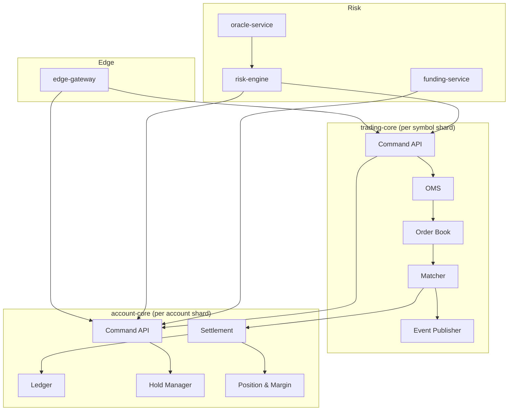

# 04 — Modules and Interfaces

---

## 1. Service boundaries



### 1.1 Dependency rules

1. `edge-gateway` depends on public contracts of all services; it never
   accesses a database.
2. `trading-core` depends on `account-core` only through the authorizing and
   releasing RPCs. It does not read balances.
3. `account-core` does not call `trading-core`. It receives settlement commands
   from the event stream or a settlement worker.
4. `risk-engine` issues commands to both cores but owns no financial state.
5. No service imports another service's database schema or internal types.
6. Shared libraries contain only primitives, contracts, and observability —
   never business rules that differ by service.

### 1.2 Repository layout (target)

```
/contracts            protobuf definitions, JSON schemas, OpenAPI, AsyncAPI
/crates
  /nexora-types       money, IDs, instrument types, errors
  /nexora-wal         WAL format, checksums, snapshots
  /nexora-ledger      double-entry engine (library)
  /nexora-book        order book and matching (library)
  /nexora-margin      margin and PnL formulas (library)
  /nexora-risk        risk policies (library)
/services
  /trading-core
  /account-core
  /risk-engine
  /oracle-service
  /funding-service
  /market-data
  /edge-gateway
  /identity-service
  /wallet-service
  /back-office-service
  /notification-service
/tools                replay, reconciliation, load generators, CLIs
/infra                Terraform, Helm, Argo manifests
/docs
```

Libraries are pure and deterministic. They have no I/O and are tested with
property-based tests. Services own I/O, configuration, and lifecycle.

---

## 2. Contract conventions

### 2.1 General

- Internal transport: gRPC with protobuf, mTLS, deadlines on every call.
- Public transport: HTTPS/JSON and WSS; OpenAPI 3.1 and AsyncAPI 3.
- Field numbers are never reused. Removed fields are marked `reserved`.
- Enums have an explicit `UNSPECIFIED = 0`; unknown values are rejected for
  commands and tolerated for events.
- All timestamps are Unix nanoseconds (`int64`) internally; ISO-8601 at the edge.
- All identifiers are strings at the edge and typed integers/UUIDs internally.
- Money is never a protobuf `double` or `float`.
- Every command carries `request_id`, `idempotency_key`, `account_id`,
  `trace_id`, and `deadline`.
- Every response carries `request_id`, `server_time_ns`, and the committed
  sequence when applicable.

### 2.2 128-bit integers on the wire

```protobuf
message Int128 {
  // Two's complement, value = (hi << 64) + lo, where lo is unsigned.
  int64  hi = 1;
  uint64 lo = 2;
}
```

Helpers in `nexora-types` convert losslessly to/from Rust `i128`. JSON APIs use
canonical decimal strings instead.

### 2.3 Error envelope

```protobuf
message Error {
  string  code = 1;          // stable machine code, e.g. INSUFFICIENT_MARGIN
  string  message = 2;       // human-readable, no secrets
  string  request_id = 3;
  int32   http_status = 4;   // edge mapping
  bool    retryable = 5;
  int64   retry_after_ms = 6;
  map<string, string> details = 7;
}
```

Error code taxonomy:

| Prefix | Meaning | Example |
|--------|---------|---------|
| `AUTH_` | Authentication/authorization | `AUTH_INVALID_SIGNATURE` |
| `VAL_` | Validation | `VAL_PRICE_TICK` |
| `MKT_` | Market/instrument state | `MKT_HALTED` |
| `ORD_` | Order state | `ORD_UNKNOWN` |
| `RSK_` | Risk/margin | `RSK_INSUFFICIENT_MARGIN` |
| `ACC_` | Account state | `ACC_FROZEN` |
| `WAL_` | Wallet/chain | `WAL_INSUFFICIENT_CONFIRMATIONS` |
| `SYS_` | Infrastructure | `SYS_SHARD_UNAVAILABLE` |
| `RATE_` | Rate limiting | `RATE_LIMIT_EXCEEDED` |

`SYS_SHARD_UNAVAILABLE` and timeouts are **ambiguous**: the caller must query
by idempotency key rather than assume failure.

---

## 3. Trading Core API

```protobuf
syntax = "proto3";
package nexora.trading.v1;

service TradingCore {
  rpc SubmitOrder(SubmitOrderRequest) returns (SubmitOrderResponse);
  rpc CancelOrder(CancelOrderRequest) returns (CancelOrderResponse);
  rpc CancelAll(CancelAllRequest) returns (CancelAllResponse);
  rpc GetOrder(GetOrderRequest) returns (GetOrderResponse);
  rpc GetOpenOrders(GetOpenOrdersRequest) returns (GetOpenOrdersResponse);
  rpc GetOrderBook(GetOrderBookRequest) returns (GetOrderBookResponse);
  rpc StreamMarketData(StreamMarketDataRequest) returns (stream MarketDataEvent);
  rpc AdminSetInstrumentState(AdminSetInstrumentStateRequest) returns (AdminSetInstrumentStateResponse);
  rpc AdminHalt(AdminHaltRequest) returns (AdminHaltResponse);
}

message SubmitOrderRequest {
  string request_id = 1;
  string idempotency_key = 2;       // account_id + client_order_id
  string account_id = 3;
  string symbol = 4;
  string client_order_id = 5;
  Side side = 6;
  OrderType order_type = 7;
  TimeInForce tif = 8;
  Int128 price_ticks = 9;           // absent for market
  Int128 qty_lots = 10;
  Int128 stop_price_ticks = 11;     // optional
  PositionSide position_side = 12;  // hedge mode
  bool reduce_only = 13;
  bool post_only = 14;
  bool close_position = 15;
  int64 expires_at_ns = 16;         // optional
  string leverage = 17;             // optional, per-order for isolated
  string margin_mode = 18;          // CROSS | ISOLATED
  int64 received_at_ns = 19;
  int32 max_slippage_bps = 20;      // market orders
}

message SubmitOrderResponse {
  string request_id = 1;
  string order_id = 2;
  string client_order_id = 3;
  OrderStatus status = 4;
  int64 accepted_seq = 5;
  repeated Fill fills = 6;
  string remaining_qty = 7;
  Error error = 8;
  int64 committed_at_ns = 9;
}
```

### 3.1 SubmitOrder semantics

1. **Idempotency:** `(account_id, client_order_id)` is unique for the lifetime
   of the account plus a retention window of 7 days. Repeating the same request
   returns the original response; reusing the key with a different payload
   returns `ORD_IDEMPOTENCY_CONFLICT`.
2. **Validation order:** authentication → account status → instrument status →
   schema/units → price band → quantity/notional bounds → self-trade
   prevention → margin authorization → book insertion.
3. **Authorization validity:** the decision is valid for 2 seconds; the
   underlying hold has a 30-second safety TTL. If the order is not committed
   within 2 seconds, the OMS releases the authorization and rejects the order.
   On `OrderAccepted`, the OMS calls idempotent `BindOrderHold` to convert the
   authorization into an **order hold** whose expiry is the order's expiry (or
   none for GTC), so a resting order remains funded for its lifetime. The 30s
   TTL covers the commit-to-bind window and crash recovery.
4. **Commit rule:** respond after WAL fsync and Raft quorum. On timeout the
   caller must query by `client_order_id`.
5. **Market orders:** require a `max_slippage_bps` or a reference price; the
   unmatched remainder is canceled (IOC semantics).
6. **Post-only:** if the order would cross, reject with `ORD_POST_ONLY_WOULD_CROSS`.
7. **Reduce-only:** quantity is capped at the current position size; excess is
   rejected or reduced according to instrument policy.
8. **Close-position:** resolves quantity at execution time from the position.

### 3.2 Cancel semantics

- Cancel by `order_id` or `client_order_id`, never both.
- Canceling a terminal order returns success with the terminal state
  (idempotent).
- Canceling an unknown order returns `ORD_UNKNOWN`.
- `CancelAll` supports symbol and side filters; it is rate-limited and returns
  counts, not per-order errors.

### 3.3 Order queries

- `GetOrder` reads from the in-memory OMS. If the shard is unavailable, the
  edge falls back to the durable Postgres projection with a `stale=true` flag.
- `GetOpenOrders` is cursor-paginated by `order_id`.
- Reads are linearizable when served by the leader with a read barrier
  (`read_index` in Raft). Follower reads are allowed only for historical
  terminal orders.

---

## 4. Account Core API

```protobuf
syntax = "proto3";
package nexora.account.v1;

service AccountCore {
  rpc AuthorizeOrder(AuthorizeOrderRequest) returns (AuthorizeOrderResponse);
  rpc BindOrderHold(BindOrderHoldRequest) returns (BindOrderHoldResponse);
  rpc ReleaseAuthorization(ReleaseAuthorizationRequest) returns (ReleaseAuthorizationResponse);
  rpc SettleTrade(SettleTradeRequest) returns (SettleTradeResponse);
  rpc ApplyFunding(ApplyFundingRequest) returns (ApplyFundingResponse);
  rpc ApplyLiquidation(ApplyLiquidationRequest) returns (ApplyLiquidationResponse);
  rpc CreateHold(CreateHoldRequest) returns (CreateHoldResponse);
  rpc ReleaseHold(ReleaseHoldRequest) returns (ReleaseHoldResponse);
  rpc GetSnapshot(GetSnapshotRequest) returns (GetSnapshotResponse);
  rpc GetPositions(GetPositionsRequest) returns (GetPositionsResponse);
  rpc AdminAdjust(AdminAdjustRequest) returns (AdminAdjustResponse);
}

message AuthorizeOrderRequest {
  string request_id = 1;
  string authorization_key = 2;     // order_id or client idempotency key
  string account_id = 3;
  string symbol = 4;
  Side side = 5;
  OrderType order_type = 6;
  Int128 price_ticks = 7;
  Int128 qty_lots = 8;
  bool reduce_only = 9;
  string margin_mode = 10;
  string leverage = 11;
  Int128 est_fee = 12;
  int64 expires_at_ns = 13;
}

message AuthorizeOrderResponse {
  string authorization_id = 1;
  Int128 reserved_collateral = 2;
  Int128 reserved_fee = 3;
  Int128 max_executable_qty = 4;
  bool approved = 5;
  Error error = 6;
}

message BindOrderHoldRequest {
  string request_id = 1;
  string authorization_id = 2;
  string order_id = 3;
  int64 expires_at_ns = 4;          // 0 = no expiry (GTC)
}

message BindOrderHoldResponse {
  string hold_id = 1;
  bool bound = 2;
  Error error = 3;
}
```

### 4.1 Authorization rules

- **Spot buy:** reserve quote = `price * qty + fee_buffer`; reserve base = 0.
- **Spot sell:** reserve base = `qty`; the fee is deducted from the quote
  proceeds, so no extra quote hold is needed. If a different fee asset is
  configured, reserve that asset instead.
- **Perp open:** reserve initial margin = `notional / leverage + fee_buffer`,
  adjusted by pending orders and existing positions.
- **Perp reduce-only:** reserve fee only; no additional margin.
- **Cross margin:** authorization checks account-level available margin across
  all positions and open orders.
- **Isolated margin:** authorization checks the position's isolated margin plus
  the order's incremental requirement.
- **Market order:** use mark price (or last price if mark unavailable) plus a
  configurable slippage buffer.
- **Hold scope:** one hold per authorization, referenced by `authorization_id`.
  Partial fills consume proportionally; cancel releases the remainder.
- **Bind:** `BindOrderHold(authorization_id, order_id, expires_at)` is
  idempotent and extends the hold to the order lifetime. Until it succeeds, the
  30-second safety TTL applies.

### 4.2 Settlement contract

```protobuf
message SettleTradeRequest {
  string request_id = 1;
  string trade_id = 2;
  string symbol = 3;
  string participant_account_id = 4;
  ParticipantSide participant_side = 5;  // BUYER | SELLER
  Int128 price_ticks = 6;
  Int128 qty_lots = 7;
  Int128 maker_fee = 8;
  Int128 taker_fee = 9;
  string order_id = 10;
  string authorization_id = 11;
  int64 executed_at_ns = 12;
}
```

Semantics:

- Idempotent on `(trade_id, participant_side)`. Repeated calls return the
  original journal ID.
- Consumes the hold referenced by `authorization_id`; if the hold is missing or
  insufficient, settlement fails closed and raises an incident alert.
- Updates position, realized PnL, and balances in one transaction.
- Writes the journal and the outbox record in the same transaction.
- Never blocks on the counterparty leg.

### 4.3 Funding contract

```protobuf
message ApplyFundingRequest {
  string request_id = 1;
  string funding_id = 2;            // symbol + interval, idempotency key
  string symbol = 3;
  int64 interval_start_ns = 4;
  int64 interval_end_ns = 5;
  string rate_bps = 6;
  repeated FundingPosition positions = 7;
}

message FundingPosition {
  string account_id = 1;
  string position_id = 2;
  Int128 notional = 3;
  Int128 payment = 4;               // positive = receive, negative = pay
}
```

- One funding batch per symbol per interval.
- Payments are computed by `funding-service` from a consistent position
  snapshot; `account-core` validates that each position's size matches its own
  state at the effective time, or applies with an explicit `STALE_SNAPSHOT`
  error that triggers recomputation.
- Rounding residue is booked to the insurance fund, and the batch remains
  balanced.

### 4.4 Hold contract (withdrawals and fees)

```protobuf
message CreateHoldRequest {
  string request_id = 1;
  string hold_key = 2;              // withdrawal_id, fee_id
  string account_id = 3;
  string asset = 4;
  Int128 amount = 5;
  HoldPurpose purpose = 6;
  int64 expires_at_ns = 7;
}
```

Holds are idempotent by `hold_key`. A hold cannot exceed available balance.
`ReleaseHold` is idempotent and records the reason.

---

## 5. Risk Engine API

```protobuf
service RiskEngine {
  rpc EvaluateAccount(EvaluateAccountRequest) returns (EvaluateAccountResponse);
  rpc PlanLiquidation(PlanLiquidationRequest) returns (PlanLiquidationResponse);
  rpc ExecuteLiquidation(ExecuteLiquidationRequest) returns (ExecuteLiquidationResponse);
  rpc PlanAdl(PlanAdlRequest) returns (PlanAdlResponse);
  rpc GetInsuranceFund(GetInsuranceFundRequest) returns (GetInsuranceFundResponse);
}
```

- `EvaluateAccount` returns margin components, liquidation price, and whether
  the account is above/below maintenance.
- `PlanLiquidation` returns an ordered set of actions: cancel orders, transfer
  isolated margin, place reduce-only orders, expected deficit.
- `ExecuteLiquidation` is idempotent by `case_id` and delegates to
  `trading-core` and `account-core`.
- ADL plans are deterministic given the same positions and mark price.

Risk-engine state is a projection of account-core events plus oracle prices. It
can be rebuilt entirely; it is never the system of record.

---

## 6. Market Data API

```protobuf
service MarketData {
  rpc GetSnapshot(GetSnapshotRequest) returns (MarketSnapshot);
  rpc GetCandles(GetCandlesRequest) returns (GetCandlesResponse);
  rpc GetTrades(GetTradesRequest) returns (GetTradesResponse);
  rpc StreamPublic(StreamPublicRequest) returns (stream PublicEvent);
}
```

Public event envelope:

```protobuf
message PublicEvent {
  string symbol = 1;
  int64  seq = 2;
  int64  event_time_ns = 3;
  oneof payload {
    BookSnapshot snapshot = 10;
    BookDelta delta = 11;
    TradePrint trade = 12;
    Ticker ticker = 13;
    MarkPrice mark = 14;
    FundingRate funding = 15;
    InstrumentUpdate instrument = 16;
  }
}
```

Ordering rule: for a symbol, `seq` is strictly increasing. A WebSocket client
that detects a gap MUST reconnect and fetch a snapshot. Snapshots carry the
`seq` they represent.

---

## 7. Wallet Service API

```protobuf
service WalletService {
  rpc GetDepositAddress(GetDepositAddressRequest) returns (GetDepositAddressResponse);
  rpc ListDeposits(ListDepositsRequest) returns (ListDepositsResponse);
  rpc RequestWithdrawal(RequestWithdrawalRequest) returns (RequestWithdrawalResponse);
  rpc CancelWithdrawal(CancelWithdrawalRequest) returns (CancelWithdrawalResponse);
  rpc ListWithdrawals(ListWithdrawalsRequest) returns (ListWithdrawalsResponse);
  rpc GetWithdrawalQuote(GetWithdrawalQuoteRequest) returns (GetWithdrawalQuoteResponse);
}
```

Withdrawal request requirements:

- Authenticated session or API key with `withdraw` scope.
- 2FA proof (TOTP or WebAuthn) within 60 seconds.
- Destination address whitelisted for at least 24 hours, unless a
  risk-approved exception exists.
- Amount within daily/monthly velocity limits and available balance.
- AML/sanctions screening on the destination address.

---

## 8. Identity Service API

```protobuf
service IdentityService {
  rpc Register(RegisterRequest) returns (RegisterResponse);
  rpc Login(LoginRequest) returns (LoginResponse);
  rpc Refresh(RefreshRequest) returns (RefreshResponse);
  rpc Logout(LogoutRequest) returns (LogoutResponse);
  rpc CreateApiKey(CreateApiKeyRequest) returns (CreateApiKeyResponse);
  rpc RevokeApiKey(RevokeApiKeyRequest) returns (RevokeApiKeyResponse);
  rpc GetPermissions(GetPermissionsRequest) returns (GetPermissionsResponse);
  rpc SubmitKyc(SubmitKycRequest) returns (SubmitKycResponse);
}
```

API key creation returns the secret exactly once. HMAC secrets are stored
encrypted with a KMS-backed envelope key and decrypted only inside the identity
service for signature verification; Ed25519 keys store only the public key.
Keys carry scopes: `read`, `trade`, `withdraw`, `transfer`, and optional IP
allowlists.

---

## 9. Back Office API

Administrative operations are separate from customer APIs:

| Operation | Approval |
|-----------|----------|
| Freeze/unfreeze account | Risk operator + audit |
| Manual ledger adjustment | Two operators (maker/checker) |
| Withdrawal approval above threshold | Two approvers + HSM quorum |
| Instrument halt/resume | Trading ops + incident ticket |
| Fee schedule change | Product owner + compliance |
| Margin tier change | Risk committee, versioned and announced |
| Insurance fund transfer | CFO + risk + dual control |
| Force settlement / ADL | Risk lead + incident commander |

All admin actions require SSO, hardware MFA, and are recorded in the WORM audit
log with before/after state.

---

## 10. Event envelope

```protobuf
message EventEnvelope {
  string event_id = 1;              // UUIDv7, globally unique
  string event_type = 2;            // e.g. trading.TradeExecuted.v1
  int64  occurred_at_ns = 3;
  int64  committed_at_ns = 4;
  string producer = 5;
  string shard = 6;
  int64  stream_seq = 7;            // per producer/shard
  string correlation_id = 8;
  string causation_id = 9;
  string trace_id = 10;
  bytes  payload = 11;              // protobuf or Avro
  string schema_version = 12;
  bytes  signature = 13;            // optional, for audit topics
}
```

Consumers:

- Deduplicate on `event_id`.
- Enforce ordering per `(producer, shard, stream_seq)`.
- Store the offset in the inbox table in the same transaction as the effect.
- Treat unknown event types as fatal for financial topics; alert and stop.
- Emit a dead-letter event after N failed attempts with full context.

---

## 11. Interface versioning

| Change | Compatibility | Action |
|--------|---------------|--------|
| Add optional field | Backward compatible | Deploy producers first |
| Add enum value | Backward compatible for events; commands must tolerate unknown | Deploy consumers first |
| Remove field | Breaking | Reserve number, new major version |
| Change units/semantics | Breaking | New field or new RPC, never in place |
| Change error code | Breaking for clients | New code, keep old for a deprecation window |

Public REST path versions (`/v1`) change only for breaking changes. WebSocket
channels are versioned in the subscription payload (`"v": 2`).

---

## 12. Module test contracts

Each library must expose deterministic functions with these properties:

- `ledger::post(batch) -> Result<Journal>` never mutates input and is
  idempotent by batch source key.
- `book::match(order, book) -> Vec<Trade>` is pure and deterministic.
- `margin::required_margin(position, price, tiers) -> Amount` is monotonic in
  price and size.
- `margin::liquidation_price(position, tiers) -> Option<Price>` returns `None`
  for cross accounts with multiple positions (computed at account level).
- `risk::rank_adl(positions, prices) -> Vec<AdlCandidate>` is stable and
  deterministic.
- `wal::append(record) -> Result<Seq>` is atomic and crash-safe.
- `wal::replay(snapshot, records) -> State` reproduces the same state hash.

Contract tests run against both the library and the service to prevent drift.
