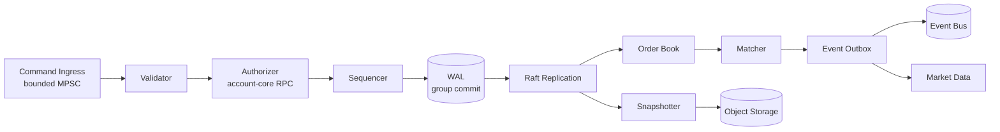

# 06 — Matching Engine

---

## 1. Requirements

| ID | Requirement |
|----|-------------|
| M1 | Strict price-time priority |
| M2 | Deterministic: identical input sequence produces identical output and state hash |
| M3 | Single writer per symbol; no locks in the hot path |
| M4 | O(1) cancel by order ID; O(log n) insert; cached O(1) best-price access |
| M5 | Durable before acknowledgement (WAL + quorum) |
| M6 | Recover to the last committed command without manual repair |
| M7 | Publish ordered market data with sequence numbers |
| M8 | Handle 30k orders/s per symbol with p99.9 match latency < 1 ms |
| M9 | No floating point; all prices and quantities are integers |
| M10 | Fail closed on invariant violations and halt the symbol |

---

## 2. Architecture



### 2.1 Threading model

Each symbol shard is an **actor** with a single dedicated thread (or a
single-threaded Tokio runtime with `current_thread`):

- One ingress queue per shard, bounded.
- One egress queue per shard, bounded.
- No `await` points inside the matching loop.
- Network I/O for authorization happens **before** the command enters the
  sequencer, so the hot loop performs no I/O except WAL append.
- WAL fsync is batched: multiple commands share one fsync (group commit) while
  preserving order.

Symbol sharding:

```
shard = symbol_id % SYMBOL_SHARD_COUNT
```

A shard owns a set of symbols but processes them sequentially. Symbols are
independent; cross-symbol operations (e.g. portfolio margin) are not part of
matching.

### 2.2 Command pipeline

1. **Ingress:** validate framing, size, and rate.
2. **Authentication context:** account ID and permissions are already verified
   by the edge; the core re-verifies the internal token.
3. **Static validation:** instrument status, tick/lot alignment, quantity
   bounds, price band, order type/TIF combination.
4. **Idempotency:** check `(account, client_order_id)` in the in-memory index;
   fall back to durable store on miss.
5. **Authorization:** call `account-core.AuthorizeOrder` with a deadline. This
   reserves funds/margin.
6. **Sequencing:** assign `seq`, bind the authorization to an order hold, and
   append `OrderAccepted` plus resulting events to the WAL batch.
7. **Matching:** run the matcher; append trades to the same WAL batch.
8. **Commit:** fsync locally, replicate via Raft, wait for quorum.
9. **Respond:** return order state and fills.
10. **Publish:** emit events to the bus and market data.

If authorization succeeds but the WAL commit fails, the authorization hold is
released by a compensating call. If the process crashes before the release, the
short authorization TTL expires and reconciliation resolves it by
`authorization_id`. Once an order is committed, its order hold lives until the
order's terminal state or expiry.

---

## 3. Data structures

### 3.1 Price levels

```rust
struct PriceLevel {
    price: Price,
    total_qty: Qty,
    order_count: u32,
    head: Option<OrderIdx>,   // oldest
    tail: Option<OrderIdx>,   // newest
}

struct OrderBook {
    bids: BTreeMap<Reverse<Price>, PriceLevel>,
    asks: BTreeMap<Price, PriceLevel>,
    orders: Slab<BookOrder>,          // O(1) index by OrderIdx
    by_id: HashMap<OrderId, OrderIdx>,
    last_seq: u64,
    state_hash: [u8; 32],
}
```

- `BTreeMap` gives `O(log n)` price-level lookup and ordered iteration.
- Each level holds an intrusive doubly-linked FIFO list for time priority.
- `Slab` avoids per-order allocation and gives stable indices.
- `by_id` enables O(1) cancel.
- `total_qty` enables depth snapshots without traversing orders.

### 3.2 Book order

```rust
struct BookOrder {
    order_id: OrderId,
    account_id: AccountId,
    side: Side,
    price: Price,
    remaining: Qty,
    prev: Option<OrderIdx>,
    next: Option<OrderIdx>,
    level_price: Price,
    created_seq: u64,
    flags: OrderFlags,       // post_only, reduce_only, close_position
    position_side: PositionSide,
}
```

### 3.3 Best price and depth

- Best bid/ask: first key of the `BTreeMap` — O(log n) or O(1) with a cached
  iterator.
- Depth snapshot: iterate levels up to N (default 50), O(N).
- Mid price: `(best_bid + best_ask) / 2`, rounded down to tick; `None` if either
  side is empty.

### 3.4 Memory budget

At 1 million resting orders per symbol:

| Structure | Approx. size |
|-----------|--------------|
| `BookOrder` (64 B) | 64 MB |
| `Slab` overhead | 8 MB |
| `HashMap` index | 48 MB |
| Price levels (10k) | < 1 MB |
| **Total** | **~125 MB** |

Capacity planning assumes 4 GB per symbol shard for book, WAL buffers, and
snapshots, with a hard limit that rejects new orders when exceeded
(`MKT_BOOK_FULL`).

---

## 4. Matching algorithm

### 4.1 Limit order

```
match_limit(order):
    if order.side == Buy:
        while order.remaining > 0 and best_ask <= order.price:
            level = best_ask_level
            fill against level.head in FIFO order
            emit Trade(order, resting, price=level.price, qty=min(...))
            update level totals, remove filled orders
            if level empty: remove level
        if order.remaining > 0:
            if order.tif in {IOC, FOK} or order.post_only:
                cancel remainder (or reject before matching for post-only/FOK)
            else:
                insert at tail of order.price level
    else: symmetric
```

### 4.2 Market order

- Execute against the opposite book until filled or the slippage bound is
  reached.
- Slippage bound: `max_slippage_bps` relative to the reference price (mark or
  last). If no bound is supplied, use the instrument default.
- Remainder is canceled (IOC semantics). No market order rests.
- If the book is empty, reject `MKT_NO_LIQUIDITY`.

### 4.3 FOK

- Pre-scan the book to compute executable quantity at the limit price.
- If `executable < qty`, reject before any trade.
- If sufficient, execute atomically as one batch.

### 4.4 Post-only

- If the order would cross at arrival, reject `ORD_POST_ONLY_WOULD_CROSS`.
- If it would rest, insert at the tail of its price level.
- Repricing after partial fill is not allowed; a post-only order that is
  partially filled (possible only in auctions) keeps its remaining quantity.

### 4.5 Self-trade prevention (STP)

Default policy: **cancel resting**.

- If the incoming order would match an order from the same account, the resting
  order is canceled and the incoming order continues.
- Alternative policies: `cancel_taker` (reject incoming), `decrement`
  (reduce both), `allow` (only for configured market makers, disabled by
  default).
- STP is evaluated before fee calculation and trade emission.
- Canceled resting orders emit `OrderCanceled` with reason `SELF_TRADE`.

### 4.6 Auctions and halts

- **Opening auction:** orders accumulate without matching; at the auction price,
  crossed orders execute at a single price that maximizes volume, with
  tie-breaking by minimum imbalance.
- **Volatility auction:** triggered by a price band breach; the book is frozen,
  indicative price is published, and the auction runs for a configured window.
- **Halt:** no new orders; cancels allowed; market data continues with a halted
  flag.
- **Reduce-only:** existing positions may be reduced, but risk-increasing orders
  are rejected.

Auction state is part of the deterministic state machine and is replayed like
any other command.

---

## 5. Determinism

### 5.1 Sources of nondeterminism (and how they are removed)

| Source | Control |
|--------|---------|
| Wall clock | Event time is assigned by the sequencer, not read inside matching |
| Randomness | No RNG in matching; tie-breakers use sequence numbers |
| HashMap iteration | Never iterate a `HashMap` when order matters; use `BTreeMap` or sort by ID |
| Floating point | Prohibited |
| Thread scheduling | Single writer; ingress order defines command order |
| External calls | Authorization happens before sequencing; oracle prices are events |
| Locale/timezone | UTC and integer timestamps only |
| Uninitialized memory | Rust safe code; `unsafe` forbidden in matching crate |

### 5.2 State hash

Two hashes are maintained:

1. **Incremental batch hash:** O(events in the batch), updated on every commit
   over the ordered commands and emitted events. It is stored in each WAL
   record.
2. **Full state hash:** O(orders + levels), computed at snapshot boundaries and
   every 1,000 batches (configurable). It covers:
   - Best bid/ask and aggregate depth (top 100 levels).
   - Number of orders and total quantity per side.
   - Each order's `(order_id, price, remaining, seq)` in book order.
   - Last sequence number.
   - Instrument state.

Both hashes are stored in snapshots. Replay must reproduce them exactly; a
mismatch halts the shard and pages the on-call engineer. The full hash is also
computed by a nightly replay job in staging.

### 5.3 Replay guarantees

- Commands are replayed in `seq` order.
- Events are derived, not stored as inputs (except external events such as
  oracle updates, which are recorded).
- Replay from the last snapshot plus WAL must complete in < 30 seconds for
  1 million commands.
- A nightly job replays a random day's commands in staging and compares hashes.

---

## 6. WAL and snapshots

### 6.1 WAL record format

```
+--------+--------+--------+---------+--------+----------+---------+
| len u32| crc32c | seq u64| term u64| type u8| flags u8 | payload |
+--------+--------+--------+---------+--------+----------+---------+
```

- `len` excludes the header.
- `crc32c` covers header fields after CRC plus payload.
- `seq` is strictly increasing per shard.
- `term` is the Raft term.
- `type` is `Command`, `SnapshotMarker`, `Noop`, `ConfigChange`.
- `payload` is protobuf or bincode with a version byte.
- Records are appended in batches with a single `fsync` (group commit).
- The WAL is preallocated in 64 MB segments; old segments are archived after
  snapshot.

### 6.2 Snapshot

- Trigger: every 100k commands, every 5 minutes, or on graceful shutdown.
- Content: instrument config version, full book, order index, idempotency
  window, last seq, state hash, code version, schema version.
- Format: compressed (zstd) protobuf, encrypted at rest.
- Storage: local NVMe + S3 with immutable object keys.
- Snapshot creation is copy-on-write or stop-the-world for < 50 ms; the actor
  pauses matching during the copy.
- Retention: last 3 snapshots locally, 30 days in S3.

### 6.3 Recovery

1. Load the latest snapshot with a verified checksum and code version.
2. Replay WAL records after the snapshot sequence.
3. Verify the state hash at the last committed sequence.
4. Rebuild derived indexes (order-by-account, idempotency map).
5. Reconcile open orders with `account-core` holds:
   - Order exists, hold missing → halt symbol, incident.
   - Hold exists, order missing → release after grace period.
6. Resume accepting commands only after a successful hash and reconciliation.

---

## 7. Replication

- Each symbol shard is a Raft group of 3 voters across AZs.
- The leader executes the deterministic state machine.
- Followers append the log and apply committed entries to a hot standby book.
- Read-only queries may be served by followers with a `stale` flag; order
  placement and cancellation require the leader.
- Leader election uses randomized timeouts (150–300 ms) and pre-vote to avoid
  disruption.
- A leader that cannot reach a quorum steps down within 2 seconds and stops
  acknowledging.
- Network partitions favor consistency: the minority partition cannot accept
  orders.

Raft log storage uses the same local NVMe as the WAL. Snapshots are shipped to
followers that fall behind.

---

## 8. Market data publication

### 8.1 Outputs per committed batch

| Output | Content |
|--------|---------|
| `OrderAccepted` | order id, account, price, qty, side, seq |
| `OrderCanceled` | order id, reason, remaining |
| `TradePrint` | price, qty, taker side, trade id, seq |
| `BookDelta` | side, price, new total qty, order count, seq |
| `Ticker` | best bid/ask, last, 24h volume, change |
| `MarkPrice` | from oracle/mark service, separate stream |
| `InstrumentUpdate` | halt/resume, config version |

### 8.2 Sequencing

- Every event carries the symbol's `seq`.
- A batch may produce multiple deltas; all share the batch `seq` and are
  delivered in deterministic order.
- `BookDelta` is a **replace** of the level's total quantity, not a delta of
  deltas. This makes recovery idempotent.
- A snapshot carries the `seq` it reflects; clients apply deltas with
  `seq > snapshot.seq`.

### 8.3 Conflation

- Market data fan-out may conflate deltas per client at a bounded rate
  (e.g. 20 ms) for slow consumers.
- A conflated delta is the **net difference** between the last state sent to
  that client and the current state, never an arbitrary subset. It carries
  `fromSeq` and `seq` so the client can validate ordering.
- Conflation drops intermediate states but never reorders; the final state is
  always delivered.
- Private order/fill streams are **not** conflated; every fill is delivered.

---

## 9. Backpressure and overload

| Condition | Action |
|-----------|--------|
| Ingress queue > 80% | Reject new orders with `SYS_BACKPRESSURE` (retryable) |
| Ingress queue > 95% | Shed market orders first, then limit orders; keep cancels |
| WAL fsync latency > 50 ms p99 | Alert; reduce batch size; consider disk issue |
| Raft replication lag > 1 s | Stop acknowledging new commands |
| Book memory > limit | Reject new resting orders; allow cancels |
| Egress queue full | Drop conflatable market data; never drop private fills |
| Settlement lag > 5 s | Trading continues but risk limits tighten; alert |

Priority lanes:

1. Cancels and risk-reducing orders.
2. Reduce-only and close-position orders.
3. Limit orders.
4. Market orders.
5. Post-only and new speculative orders.

Starvation is prevented by weighted fair queuing within each priority.

---

## 10. Circuit breakers and price bands

- **Price band:** order price must be within `price_band_bps` of the reference
  price (mark or last). Breach → reject `MKT_PRICE_BAND`.
- **Dynamic band:** widens in high volatility, capped by instrument config.
- **Velocity limit:** if price moves more than X% in Y seconds, trigger a
  volatility auction.
- **Max order size:** per instrument and per account.
- **Max open orders:** per account and symbol.
- **Cancel ratio:** excessive cancels trigger throttling.
- **Oracle divergence:** if mark deviates from index by more than the configured
  band, halt new risk and freeze mark updates.
- **Insurance fund floor:** if below floor, reduce max leverage and enable ADL
  readiness.

Circuit breaker decisions are deterministic events and are replayed.

---

## 11. Performance engineering

- Preallocate order slab and price-level maps at startup.
- Use `SmallVec` for per-trade fill lists to avoid heap allocation.
- Avoid `String` in the hot path; use interned symbol/asset IDs.
- Batch WAL writes and fsyncs.
- Pin the actor thread to a dedicated core; isolate it from the OS scheduler
  noise (`isolcpus`, `nohz_full` where available).
- Disable transparent huge pages or tune them for predictable latency.
- Use `io_uring` or `O_DIRECT` for WAL if supported; benchmark both.
- Avoid logging in the hot path; use lock-free ring buffers for trace events.
- Benchmark with realistic order flow: 70% cancels, 20% limit, 10% market.

Benchmarks (targets, measured in B15):

| Metric | Target |
|--------|--------|
| Match latency p50 | < 50 µs |
| Match latency p99 | < 300 µs |
| Match latency p99.9 | < 1 ms |
| Orders/s per shard | 30,000 |
| Cancels/s per shard | 60,000 |
| Book rebuild from snapshot | < 10 s |
| WAL replay | > 200k commands/s |

---

## 12. Testing strategy

| Test | Purpose |
|------|---------|
| Unit tests per order type | Exact fill sequences |
| Property tests | No crossed book, quantity conservation, price-time priority |
| Model-based tests | Compare against a simple reference matcher on random inputs |
| Deterministic replay | Same log → same state hash |
| Fuzz tests | Malformed commands, extreme prices/quantities |
| Chaos tests | Kill leader at random points; verify no duplicate trades |
| Load tests | Sustained and burst throughput, tail latency |
| Invariant monitors | Book never crossed; totals match sum of orders |

Key invariants checked after every operation in tests:

1. Best bid < best ask, or one side empty.
2. Level total = sum of resting order quantities at that level.
3. Order count per level = number of orders in the FIFO list.
4. No order appears twice.
5. Filled quantity never exceeds order quantity.
6. A trade always involves one buy and one sell.
7. Buyer and seller are distinct accounts.
8. Trade price respects both orders' limits.
9. Trade quantity is a positive multiple of lot size.
10. Sequence numbers are strictly increasing.

---

## 13. Failure handling

| Failure | Behavior |
|---------|----------|
| Authorization timeout | Reject order with retryable error; no book mutation |
| WAL write failure | Fence the shard; stop accepting; step down |
| Quorum lost | Stop acknowledging; followers wait for election |
| State hash mismatch | Halt symbol; page on-call; do not auto-repair |
| Invariant violation | Halt symbol; preserve WAL and snapshot for forensics |
| Snapshot corruption | Fall back to previous snapshot + WAL replay |
| Out-of-order command | Reject; sequence gap triggers incident |
| Duplicate command | Return original result from idempotency index |
| Clock jump | Ignore wall clock for matching; use sequencer time |

A halted symbol requires an explicit operator action to resume, with a reason
recorded in the audit log. Automatic resume is forbidden after a hash or
invariant failure.

---

## 14. Interfaces exposed by the matcher library

```rust
pub trait MatchingEngine {
    fn submit(&mut self, cmd: SubmitCommand) -> SubmitOutcome;
    fn cancel(&mut self, cmd: CancelCommand) -> CancelOutcome;
    fn cancel_all(&mut self, filter: CancelFilter) -> CancelAllOutcome;
    fn snapshot(&self) -> BookSnapshot;
    fn state_hash(&self) -> [u8; 32];
    fn apply_external(&mut self, event: ExternalEvent) -> Result<(), EngineError>;
}

pub struct SubmitOutcome {
    pub order: OrderState,
    pub trades: Vec<Trade>,
    pub events: Vec<OrderEvent>,
    pub seq: u64,
}
```

The library is pure: it does not perform I/O, read the clock, or call external
services. The service wrapper supplies authorization results and persistence.
