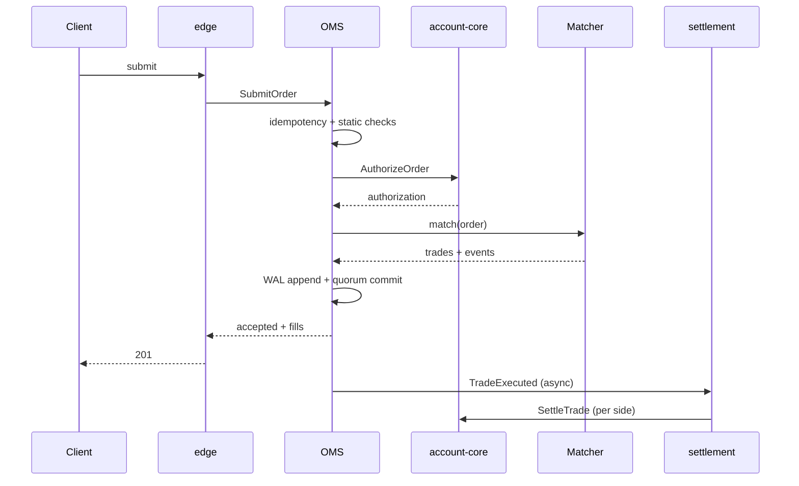

# 07 — Order Management

---

## 1. Responsibilities

The Order Management System (OMS) inside `trading-core`:

1. Authenticates the order's account context (via the edge).
2. Enforces idempotency and static validation.
3. Requests pre-trade authorization from `account-core`.
4. Assigns order IDs and sequence numbers.
5. Maintains the authoritative order state machine.
6. Submits accepted orders to the matching engine.
7. Handles cancel, cancel-all, and trigger activation.
8. Emits order events and fills.
9. Exposes order queries.
10. Reconciles its state with the durable projection and account holds.

The OMS does **not** compute margin, move money, or decide liquidations.

---

## 2. Order identity

| Identifier | Scope | Purpose |
|------------|-------|---------|
| `order_id` | Unique per symbol shard | Canonical exchange identifier |
| `client_order_id` | Unique per account | Client idempotency and lookup |
| `request_id` | Unique per API request | Tracing and replay |
| `authorization_id` | Unique per reservation | Links order to hold |
| `seq` | Monotonic per symbol | Deterministic ordering |

`order_id` format:

```
bits 63..48 : shard id (16 bits)
bits 47..0  : per-shard monotonic counter (48 bits)
```

This yields globally unique, sortable IDs without coordination. The counter is
persisted in the WAL and snapshotted.

`client_order_id` rules:

- 1–36 characters, `[A-Za-z0-9_-]`.
- Unique per account across all symbols for 7 days.
- Reuse with a different payload → `ORD_IDEMPOTENCY_CONFLICT`.
- Reuse after the retention window is allowed but discouraged; clients should
  use UUIDs.

---

## 3. Validation pipeline

Validation is ordered from cheapest to most expensive and stops at the first
failure.

### 3.1 Stage 1 — Edge validation

| Check | Error |
|-------|-------|
| TLS, signature, timestamp skew ≤ 5 s | `AUTH_*` |
| API key scope includes `trade` | `AUTH_SCOPE` |
| Account status active | `ACC_FROZEN` |
| Symbol exists and is tradable | `MKT_UNKNOWN` / `MKT_HALTED` |
| JSON schema, required fields, string lengths | `VAL_SCHEMA` |
| Decimal format and scale | `VAL_SCALE` |
| Rate limit | `RATE_LIMIT_EXCEEDED` |
| IP allowlist | `AUTH_IP_NOT_ALLOWED` |

### 3.2 Stage 2 — Trading core static validation

| Check | Error |
|-------|-------|
| Price aligned to tick | `VAL_PRICE_TICK` |
| Quantity aligned to lot | `VAL_QTY_LOT` |
| Quantity within min/max | `VAL_QTY_RANGE` |
| Notional within min/max | `VAL_NOTIONAL_RANGE` |
| Price within band | `MKT_PRICE_BAND` |
| Order type/TIF combination valid | `VAL_TIF` |
| Market order has slippage bound or default exists | `VAL_SLIPPAGE_REQUIRED` |
| Post-only does not cross | `ORD_POST_ONLY_WOULD_CROSS` |
| Reduce-only consistent with position | `ORD_REDUCE_ONLY` |
| Close-position has an open position | `ORD_NO_POSITION` |
| Max open orders per account/symbol | `RSK_MAX_OPEN_ORDERS` |
| Max order count per second | `RATE_ORDER_RATE` |
| Self-trade policy | handled by matcher |

### 3.3 Stage 3 — Financial authorization

| Check | Error |
|-------|-------|
| Spot buy: sufficient quote incl. fee buffer | `RSK_INSUFFICIENT_BALANCE` |
| Spot sell: sufficient base | `RSK_INSUFFICIENT_BALANCE` |
| Perp: sufficient initial margin | `RSK_INSUFFICIENT_MARGIN` |
| Perp: leverage within tier | `RSK_LEVERAGE_EXCEEDED` |
| Perp: position limit | `RSK_POSITION_LIMIT` |
| Account risk state normal | `RSK_ACCOUNT_RESTRICTED` |
| Symbol risk state normal | `RSK_SYMBOL_RESTRICTED` |

Authorization returns a decision valid for 2 seconds and a hold with a
30-second safety TTL. The OMS must commit or release within the 2-second
decision window. On commit, it calls idempotent `BindOrderHold` to convert the
reservation into an order hold that persists until the order is filled,
canceled, or expires. The 30-second TTL covers the commit-to-bind window.

---

## 4. Lifecycle



### 4.1 Timestamps

| Timestamp | Meaning |
|-----------|---------|
| `received_at_ns` | Edge ingress |
| `accepted_at_ns` | WAL commit |
| `triggered_at_ns` | Stop/TP/SL activation |
| `executed_at_ns` | Match time, assigned by sequencer |
| `settled_at_ns` | Ledger application |

Matching uses `executed_at_ns` only for reporting; it never reads the clock.

### 4.2 Order expiry

- `GTC`: rests until canceled or filled.
- `IOC`: executes immediately, cancels remainder.
- `FOK`: all-or-nothing.
- `GTD`: expires at `expires_at_ns`; a timer event is injected into the
  sequencer, not handled by a wall-clock thread.
- `DAY`: expires at the instrument's session close.
- Expiry events are ordered with other commands and are replayable.

Expiry is enforced by a **timer wheel** that emits `ExpireOrder` commands into
the same ingress queue. The wheel never mutates the book directly.

---

## 5. Stop, take-profit, and trailing orders

### 5.1 Trigger sources

| Source | Description |
|--------|-------------|
| `LastPrice` | Last traded price |
| `MarkPrice` | Mark price from the oracle/mark service |
| `IndexPrice` | Index price |

Trigger conditions:

- Stop-market buy: `trigger_price >= stop_price`.
- Stop-market sell: `trigger_price <= stop_price`.
- Take-profit buy: `trigger_price <= stop_price`.
- Take-profit sell: `trigger_price >= stop_price`.
- Trailing stop: trigger when price retraces `trailing_delta` from the
  extreme reached since placement.

### 5.2 Trigger lifecycle

1. Order accepted and authorized with an estimated margin.
2. Stored in a trigger index keyed by `(symbol, source, trigger_price)`.
3. On each price update, the sequencer evaluates affected triggers in
   deterministic order (price level, then order ID).
4. Triggered orders are re-validated and re-authorized at the current price.
5. If authorization fails, the order is rejected with the reason.
6. `close_position` orders resolve quantity from the position at trigger time.
7. One-shot: a triggered order never re-arms.

### 5.3 Trigger ordering

If multiple triggers fire at the same price, they execute in ascending
`order_id` order. This is deterministic and auditable.

---

## 6. Cancel and amend

### 6.1 Cancel

- By `order_id` or `client_order_id`, not both.
- Resting orders: remove from book, append `OrderCanceled`, release hold.
- Partially filled orders: release the unfilled portion.
- Trigger orders: remove from trigger index, release hold.
- Terminal orders: return idempotent success with the terminal state.
- Unknown order: `ORD_UNKNOWN` (404 at the edge).

### 6.2 Cancel-all

Filters:

- `symbol` (required for public API, optional for admin).
- `side` (buy/sell).
- `position_side` (long/short in hedge mode).
- `reduce_only` flag.

Semantics:

- Cancels all matching open orders.
- Returns counts and a list of canceled IDs (bounded; pagination for large
  sets).
- Executes as a single deterministic command in the sequencer.
- Releases holds in batches; partial release failure is retried idempotently.

### 6.3 Amend

The first release implements amend as **cancel-replace**:

1. Cancel the existing order (releasing its hold).
2. Submit a new order with a new `order_id`.
3. Preserve `client_order_id` only if the client explicitly requests it and the
   old order is terminal.

Native amend (price/quantity change without losing queue priority) is out of
scope because it complicates fairness and authorization. Clients that need it
can use cancel-replace with a new client ID.

### 6.4 Mass cancel on risk events

When an account is liquidated or frozen, the risk engine issues a privileged
`CancelAll` with reason `LIQUIDATION` or `COMPLIANCE`. This command has priority
over new orders and bypasses normal rate limits, but is audited.

---

## 7. Reduce-only and close-position

### 7.1 Reduce-only

- The order may only decrease the absolute position size.
- If the account has no position on the specified side, reject
  `ORD_REDUCE_ONLY_NO_POSITION`.
- If quantity exceeds the position, either reject or cap to the position size
  according to instrument config (`reduce_only_mode = reject | cap`).
- In hedge mode, reduce-only applies to the specified `position_side`.
- In one-way mode, a reduce-only order cannot flip the position.

### 7.2 Close-position

- Quantity is resolved at execution time from the current position.
- `side` is derived from the position direction.
- Always reduce-only.
- If the position is zero, reject `ORD_NO_POSITION`.
- If the position changes between submission and trigger, the resolved quantity
  reflects the position at trigger time.

---

## 8. One-way vs hedge mode

| Aspect | One-way | Hedge |
|--------|---------|-------|
| Position | Single net position per symbol | Separate long and short positions |
| Order side | Buy/sell | Buy/sell plus `position_side` |
| Reduce-only | Cannot flip | Applies per side |
| Close | Closes net position | Closes selected side |
| Conflict | Opening opposite side reduces/flips | Long and short can coexist |
| Margin | Net exposure | Sum of both sides' margin |

Mode changes:

- Allowed only when no open orders and no open positions for the symbol.
- Changing mode is a command with an audit record.
- In-flight orders are canceled before the change.

---

## 9. Order limits and throttling

| Limit | Default | Scope |
|-------|---------|-------|
| Open orders | 200 | Account/symbol |
| Open orders | 1,000 | Account |
| Orders/s | 50 | Account |
| Cancels/s | 100 | Account |
| Order-to-trade ratio | 100:1 | Account, rolling 1 min |
| Max order notional | Instrument tier | Account |
| Max position notional | Risk tier | Account/symbol |

Limits are enforced at the edge with a local token bucket and at the core with
an authoritative counter. The core counter wins on conflict.

When a limit is exceeded:

- Reject with `RATE_*` or `RSK_*`.
- Include `retry_after_ms`.
- Do not cancel existing orders automatically unless the risk policy requires
  it.

---

## 10. Reject reasons

| Code | HTTP | Retryable | Meaning |
|------|------|-----------|---------|
| `VAL_SCHEMA` | 400 | No | Malformed request |
| `VAL_PRICE_TICK` | 400 | No | Price not aligned |
| `VAL_QTY_LOT` | 400 | No | Quantity not aligned |
| `VAL_QTY_RANGE` | 400 | No | Outside min/max |
| `VAL_NOTIONAL_RANGE` | 400 | No | Notional outside bounds |
| `VAL_TIF` | 400 | No | Invalid type/TIF combination |
| `MKT_UNKNOWN` | 404 | No | Unknown symbol |
| `MKT_HALTED` | 409 | Yes* | Symbol halted |
| `MKT_PRICE_BAND` | 400 | Yes* | Price outside band |
| `MKT_NO_LIQUIDITY` | 409 | Yes* | No liquidity for market order |
| `ORD_POST_ONLY_WOULD_CROSS` | 400 | No | Post-only would take |
| `ORD_REDUCE_ONLY` | 400 | No | Reduce-only violation |
| `ORD_NO_POSITION` | 400 | No | Close with no position |
| `ORD_UNKNOWN` | 404 | No | Unknown order |
| `ORD_IDEMPOTENCY_CONFLICT` | 409 | No | Key reused with different payload |
| `RSK_INSUFFICIENT_BALANCE` | 400 | Yes* | Not enough available balance |
| `RSK_INSUFFICIENT_MARGIN` | 400 | Yes* | Not enough margin |
| `RSK_LEVERAGE_EXCEEDED` | 400 | No | Leverage above tier |
| `RSK_POSITION_LIMIT` | 400 | No | Position limit reached |
| `ACC_FROZEN` | 403 | No | Account frozen |
| `RATE_LIMIT_EXCEEDED` | 429 | Yes | Rate limited |
| `SYS_BACKPRESSURE` | 503 | Yes | Overloaded |
| `SYS_SHARD_UNAVAILABLE` | 503 | Yes | Leader unavailable |
| `SYS_IN_PROGRESS` | 409 | Yes | Duplicate in flight |

`*` retryable after the condition changes, not immediately.

---

## 11. Query semantics

- `GetOrder` by `order_id` or `client_order_id`.
- `GetOpenOrders` returns cursor-paginated results sorted by `order_id`.
- `GetOrderHistory` is served from the Postgres projection or ClickHouse, not
  the in-memory OMS.
- Open-order queries are linearizable on the leader.
- Historical queries may be stale; the response includes `as_of`.
- A client that just placed an order can read its state from the submission
  response; no read barrier is needed.

### 11.1 Trade and fill queries

- `GET /orders/{id}/fills` returns fills in execution order.
- Fills include fee, fee asset, maker/taker, and liquidity role.
- Trades are public (price, qty, taker side, time); account identities are
  never exposed.

---

## 12. Persistence and projection

The OMS is authoritative in memory and in its WAL. Postgres is a durable
projection for queries and recovery:

- On commit, the WAL record is appended.
- An asynchronous projector writes orders, order events, trades, and fills to
  Postgres via the outbox.
- Projection lag is monitored; it does not affect trading.
- If the projection is lost, it is rebuilt from WAL/snapshots and the event
  stream.
- The projector is idempotent on `(symbol_id, order_id, seq)` and
  `(symbol_id, trade_id)`.

Open orders in the projection are marked `stale` if the shard is unavailable.
The edge must never serve a terminal state from a stale projection without a
warning.

---

## 13. Reconciliation with account-core

Every N seconds (default 5), the OMS compares open orders with account holds:

| Condition | Action |
|-----------|--------|
| Open order, no active hold | Halt symbol; page on-call |
| Active hold, no open order and no terminal event | Release after grace period |
| Hold remaining ≠ order remaining | Alert; adjust only via audited repair |
| Terminal order with active hold | Release hold, alert |
| Duplicate settlement | Dedupe by `(trade_id, side)` |

Reconciliation is read-only by default. Repairs require an operator command
with a reason and are limited to holds, never to order state.

---

## 14. Operational controls

| Control | Scope | Who |
|---------|-------|-----|
| Halt/resume symbol | Symbol | Trading ops |
| Cancel-all for symbol | Symbol | Trading ops |
| Cancel-all for account | Account | Risk/compliance |
| Freeze account | Account | Risk/compliance |
| Change instrument config | Symbol | Product + risk |
| Enable reduce-only | Symbol | Risk |
| Disable post-only | Symbol | Trading ops |
| Force expiry | Symbol | Trading ops |

All controls are commands through the same deterministic sequencer, recorded in
the audit log with actor and reason.

---

## 15. Common failure modes and mitigations

| Failure | Mitigation |
|---------|------------|
| Client retries after timeout | Idempotency by `client_order_id`; query before retry |
| Duplicate cancel | Idempotent terminal-state response |
| Hold leak after crash | TTL + reconciliation by `authorization_id` |
| Order accepted but not projected | Rebuild projection from WAL; client sees submission response |
| Trigger fires twice | One-shot flag + deterministic event |
| Price band misconfiguration | Versioned config, canary, automatic rollback |
| Clock skew on expiry | Sequencer time, not wall clock |
| Self-trade loop | STP enabled by default; market-maker exemption audited |
| Thundering herd on halt | Jittered retries, load shedding, status page |
