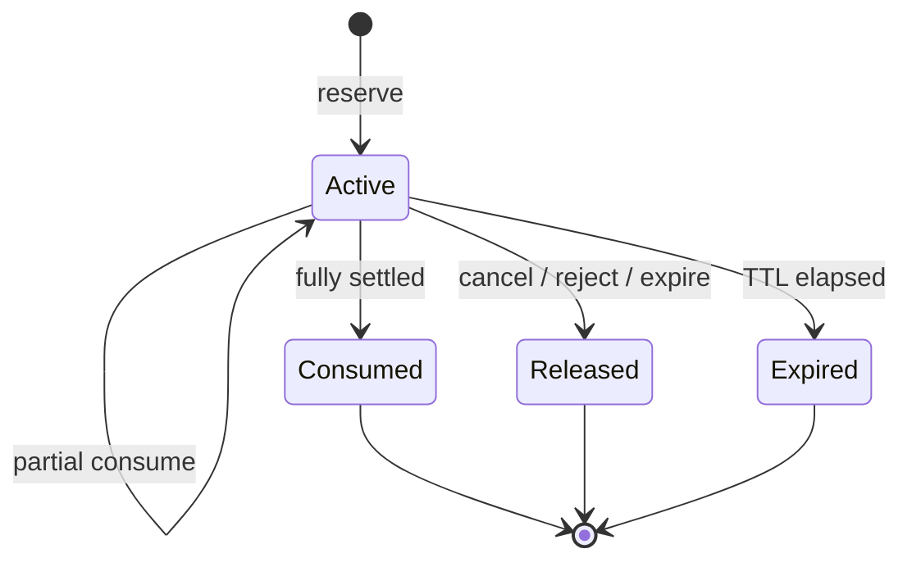
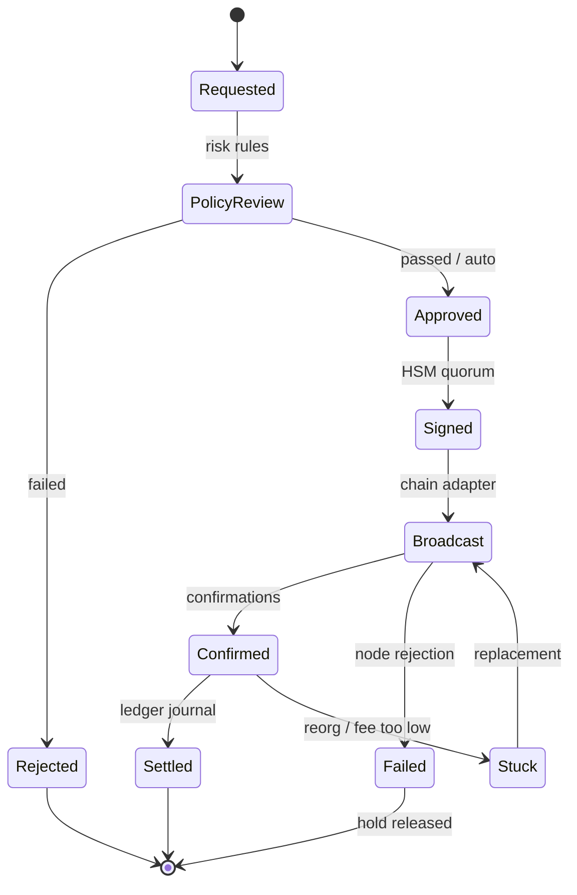

# 08 — Ledger, Wallets and Settlement

---

## 1. Model

NEXORA uses a **double-entry, multi-asset ledger**. Every financial effect is a
balanced journal batch. Balances are projections; the journal is the source of
truth.

### 1.1 Sign convention

All accounts are positions in a pooled pool of assets. Amounts are signed:

- **Positive (debit):** increases the account's claim/position.
- **Negative (credit):** decreases the account's claim/position.

For every journal batch and every asset:

```
sum(entries.amount) = 0
```

Customer accounts normally have positive balances. System accounts (clearing,
custody, fee, insurance) may be negative or positive depending on their role.
This is an internal exchange ledger, not a GAAP balance sheet; regulatory
reporting maps these accounts to assets and liabilities separately.

### 1.2 Atomicity unit

A journal batch is the atomic unit:

- All entries commit or none.
- The batch header, entries, balance updates, and outbox record are written in
  one database transaction.
- The batch hash chains to the previous batch in the shard.

---

## 2. Chart of accounts

| Account type | Owner | Purpose | May go negative |
|--------------|-------|---------|-----------------|
| `USER_SPOT` | User | Spot wallet per asset | No |
| `USER_FUTURES` | User | USDT-M collateral wallet | No (after liquidation) |
| `USER_FUNDING` | User | Funding accrual (optional segregation) | No |
| `SYSTEM_CLEARING` | System | Counterparty for settlement legs | Yes |
| `SYSTEM_CUSTODY` | System | On-chain assets held by the exchange | Yes |
| `SYSTEM_FEE` | System | Trading and withdrawal fees | Yes |
| `SYSTEM_INSURANCE` | System | Liquidation deficit absorption | Yes |
| `SYSTEM_ADL` | System | ADL settlement residue | Yes |
| `SYSTEM_FUNDING_POOL` | System | Funding clearing | Yes |
| `SYSTEM_ROUNDING` | System | Rounding residue | Yes |
| `SYSTEM_TRANSIT` | System | Deposits/withdrawals in flight | Yes |

One account row exists per `(owner_id, wallet_type, asset_id)`. System accounts
are created at bootstrap with fixed UUIDs.

**Clearing accounts are sharded.** Each ledger shard has its own
`SYSTEM_CLEARING` account per asset, keyed by the shard's system owner ID. A
settlement leg uses the clearing account of the participant's shard, so a global
clearing row never becomes a serialization bottleneck. Each shard remains
balanced on its own; global reconciliation sums all shard clearing accounts to
verify the platform-wide zero-sum invariant.

### 2.1 Account creation rules

- A user gets a spot account per asset on first deposit or trade.
- A user gets a futures account in USDT on first futures transfer or trade.
- Account creation is idempotent on `(owner_id, wallet_type, asset_id)`.
- Account status starts `active`; compliance may set `frozen` or
  `withdrawal_only`.
- Closed accounts must have zero posted and zero held balance.

---

## 3. Posting matrix

### 3.1 Spot trade

Trade: buyer buys 0.5 BTC at 60,000 USDT; taker fee 10 bps (30 USDT).

Buyer leg:

| Account | Asset | Amount | Meaning |
|---------|-------|--------|---------|
| Buyer spot | BTC | +50,000,000 | Receive 0.5 BTC |
| Clearing | BTC | −50,000,000 | Deliver |
| Buyer spot | USDT | −30,030,000,000 | Pay 30,000 + 30 fee |
| Clearing | USDT | +30,000,000,000 | Receive principal |
| Fee | USDT | +30,000,000 | Fee income |

Seller leg:

| Account | Asset | Amount | Meaning |
|---------|-------|--------|---------|
| Seller spot | BTC | −50,000,000 | Deliver 0.5 BTC |
| Clearing | BTC | +50,000,000 | Receive |
| Seller spot | USDT | +29,970,000,000 | Receive 30,000 − 30 fee |
| Clearing | USDT | −30,000,000,000 | Pay principal |
| Fee | USDT | +30,000,000 | Fee income |

After both legs, clearing nets to zero for BTC and USDT. Each leg is balanced
independently, so a delayed leg only creates a temporary clearing imbalance.

### 3.2 Perpetual futures trade

No principal changes hands. On execution:

| Account | Asset | Amount | Meaning |
|---------|-------|--------|---------|
| Buyer futures | USDT | −fee | Taker fee |
| Fee | USDT | +fee | Fee income |
| Seller futures | USDT | −fee | Maker fee |
| Fee | USDT | +fee | Fee income |

Opening a position does not move margin; margin is a **hold**, not a transfer.
When a position is reduced or closed, realized PnL moves between the trader and
the clearing account:

- Winner: `user +pnl`, `clearing −pnl`.
- Loser: `user −pnl`, `clearing +pnl`.

This keeps each leg balanced and avoids cross-account locks.

Example: a long closes 0.1 BTC at 61,000 with entry 60,000, realizing 100 USDT
and paying a 3 USDT fee:

| Account | Asset | Amount |
|---------|-------|--------|
| User futures | USDT | +97 |
| Clearing | USDT | −100 |
| Fee | USDT | +3 |

The user receives the realized PnL minus the fee; clearing pays the 100 USDT
PnL and the fee account receives the 3 USDT fee, so the batch nets to zero.

### 3.3 Funding

For a positive funding rate, longs pay shorts. Per position:

| Account | Asset | Amount |
|---------|-------|--------|
| Long futures | USDT | −payment |
| Funding pool | USDT | +payment |
| Short futures | USDT | +payment |
| Funding pool | USDT | −payment |

When processed as a batch, the pool nets to zero. Rounding residue is posted to
the insurance fund or rounding account so the batch balances exactly.

### 3.4 Liquidation

Closing a liquidated position realizes PnL as above, plus:

| Account | Asset | Amount | Meaning |
|---------|-------|--------|---------|
| User futures | USDT | −penalty | Liquidation fee |
| Insurance | USDT | +penalty | Fund contribution |
| Insurance | USDT | −deficit | Cover negative equity |
| Clearing | USDT | +deficit | Offset realized loss |

If the insurance fund cannot cover the deficit, ADL transfers value from
profitable opposing positions at the bankruptcy price, and any residual is
socialized only as a last resort with governance approval.

### 3.5 Deposit

| Account | Asset | Amount |
|---------|-------|--------|
| User spot | USDT | +amount |
| Custody | USDT | −amount |

The custody account represents the exchange's pooled on-chain holdings. The
ledger records the customer's claim; the chain records the asset.

### 3.6 Withdrawal

| Account | Asset | Amount |
|---------|-------|--------|
| User spot | USDT | −(amount + fee) |
| Custody | USDT | +amount |
| Fee | USDT | +fee |

The on-chain transfer is authorized only after the hold is created. Settlement
happens after the configured confirmations. If the transaction fails before
broadcast, the hold is released. If it is broadcast and stuck, the hold remains
and a case is opened.

### 3.7 Internal transfer (spot ↔ futures)

| Account | Asset | Amount |
|---------|-------|--------|
| User spot | USDT | −amount |
| User futures | USDT | +amount |

Transfers are instant, free (unless configured), and idempotent by
`transfer_id`. They are blocked when either account is frozen or when open
orders/positions would breach margin after the transfer.

### 3.8 Fees

Fees are recognized when the trade settles:

- Maker fee and taker fee are separate entries.
- Negative fees (rebates) reverse the sign.
- Fee asset is the quote asset for spot and USDT for perps, unless a discount
  token is configured.
- Fee rounding is always **up** to the asset's atomic unit, favoring the
  exchange; the remainder is negligible and tracked.

---

## 4. Holds (reservations)

### 4.1 Lifecycle



### 4.2 Rules

1. A hold is created only if `available >= amount`.
2. `held` increases by `amount`; `available` decreases by the same.
3. Consumption reduces `remaining` and `held`; the corresponding journal entry
   debits the account.
4. Release reduces `remaining` and `held`; no journal entry.
5. A hold cannot be partially released below zero or consumed beyond
   `remaining`.
6. Holds have a TTL by purpose:
   - **Authorization hold:** 30-second safety TTL; the decision itself is valid
     for 2 seconds. It is bound to the order on commit or released on failure.
   - **Order hold:** the order's expiry (GTD/day) or no expiry (GTC); it is
     released only on fill, cancel, or expiry.
   - **Withdrawal hold:** 24 hours, extended if the transaction is broadcast.
   - **Liquidation hold:** 1 hour.
7. Expired holds are released by a background job, except holds tied to an
   active withdrawal broadcast, which require manual resolution.

### 4.3 Available balance

```
available = posted - sum(active holds.remaining)
```

The `accounts.available` generated column uses `held`, which is maintained
transactionally. A trigger or application check ensures `held` equals the sum
of active holds at commit. Nightly reconciliation recomputes both.

### 4.4 Why holds are not journal entries

A hold is a lien, not a transfer. Posting it to the journal would create
artificial balances and complicate reversal. Keeping holds separate makes the
journal a clean record of actual value transfers.

---

## 5. Settlement

### 5.1 Settlement worker

A dedicated worker consumes `trading.events.v1` partitioned by `account_id` and
calls `account-core.SettleTrade` for each participant side.

Properties:

- **Idempotent:** unique `(trade_id, participant_side)`.
- **Ordered per account:** partition key is `account_id`, so a single account's
  trades apply in order.
- **Bounded lag:** target p99 < 250 ms; alert at 1 s; tighten risk at 5 s.
- **Retry:** exponential backoff with jitter, max 10 attempts, then dead-letter
  and page.
- **Poison messages:** a settlement that fails validation is quarantined; the
  account is frozen for withdrawals until resolved.

### 5.2 Settlement transaction

```
BEGIN;
SET LOCAL lock_timeout = '2s';
SELECT ... FROM accounts
 WHERE account_id IN ($user, $clearing) ORDER BY account_id FOR UPDATE;
-- verify hold and available
INSERT INTO journal_batches ...;
INSERT INTO journal_entries ...;
UPDATE accounts SET posted = posted + delta, held = held - consumed, version = version + 1 ...;
UPDATE positions ...;
UPDATE margin_accounts ...;
INSERT INTO ops.outbox ...;
COMMIT;
```

The transaction:

- Locks accounts in ascending UUID order.
- Verifies the hold belongs to the order and has sufficient remaining.
- Recomputes position and realized PnL from the fill.
- Updates the margin cache.
- Writes the outbox event for downstream consumers.

### 5.3 Handling an insufficient hold

If the hold is missing or too small:

1. Do not settle.
2. Emit `SettlementMismatch` with full context.
3. Freeze withdrawals for the account.
4. Page the on-call engineer.
5. Reconcile against the order WAL; repair only with an audited adjustment.

This should never happen in normal operation; it indicates a bug or a lost
command.

### 5.4 Settlement ordering vs. market data

Market data (trades, book) is published from the matching core immediately.
Private balance/position updates are published after settlement. A client may
see a fill before its balance changes; the private stream includes a
`settled=false` flag initially and a `PositionChanged`/`BalanceChanged` event
after settlement. The API documents this eventual-consistency window.

---

## 6. Deposits

### 6.1 Address assignment

- HD wallets: derive a unique address per user per network from an xpub; the
  private key stays in the HSM/custody provider.
- MPC wallets: request an address from the custody provider and map it to the
  user.
- Memo/tag chains: assign a unique memo per user under a shared deposit address.
- Address reuse is allowed but discouraged; rotation is supported.

### 6.2 Detection and confirmation

1. Chain watcher observes a transaction.
2. Normalize to `(network, txid, vout)`, amount, from/to, memo.
3. Match to a deposit address or memo.
4. Validate asset/network, minimum amount, contract address (for tokens), and
   memo presence.
5. Screen the source address (sanctions, high-risk exposure).
6. Wait for `confirmations` (network-specific).
7. Credit the ledger idempotently on `(network, txid, vout)`.
8. Emit `DepositCredited`.

### 6.3 Reorgs

- A deposit is not credited before the configured confirmation depth.
- If a reorg occurs after crediting, the wallet service emits `DepositReorged`.
- The ledger posts a reversing journal **only if** the funds are still
  available; otherwise the account is frozen and a negative balance case is
  opened.
- Contract addresses are validated against the configured token contract to
  prevent fake-token deposits.

### 6.4 Unsupported or misdirected deposits

- Unsupported assets are not credited automatically.
- A recovery workflow requires manual approval and, for some chains, a
  sweep transaction.
- Deposits below the minimum are held in a suspense account and reviewed.

---

## 7. Withdrawals

### 7.1 Request

Required:

- Asset, network, destination address, amount.
- 2FA proof within 60 seconds.
- Withdrawal scope on the API key (if API).
- Destination whitelisted (24-hour cool-off unless risk-approved).
- Sufficient available balance.
- Velocity limits (daily, monthly, per-address).
- AML/sanctions screening.

### 7.2 State machine



### 7.3 Hold and settlement

1. Create a hold on the user's spot account for `amount + fee`.
2. Sign and broadcast.
3. On confirmation, post the withdrawal journal and consume the hold.
4. On failure before broadcast, release the hold.
5. On failure after broadcast, retain the hold and open a case; never
   double-spend.

### 7.4 Withdrawal limits and approvals

| Tier | Daily limit | Approval |
|------|-------------|----------|
| KYC 1 | 2,000 USDT | Automatic |
| KYC 2 | 50,000 USDT | Automatic + 2FA |
| KYC 3 | 500,000 USDT | Risk review above 100k |
| Institutional | Custom | Dual approval + HSM quorum |

Limits are configurable per jurisdiction and are enforced in the wallet service
with a ledger-level hold as the final guard.

### 7.5 Fee handling

- Network fee is quoted from the chain adapter with a buffer.
- The user-facing fee is fixed per network and reviewed daily.
- The difference between the charged fee and the actual network fee is booked
  to the fee account or a gas treasury account.
- Fee changes are versioned and announced.

---

## 8. Reconciliation

### 8.1 Ledger reconciliation (continuous)

| Check | Frequency | Action on failure |
|-------|-----------|-------------------|
| Batch balances per asset | Every batch | Reject commit |
| `posted = sum(entries)` per account | Hourly | Freeze account, page |
| `held = sum(active holds)` | Hourly | Freeze account, page |
| `available >= 0` for customers | Every transaction | Reject transaction |
| Global sum per asset = 0 | Hourly | Halt withdrawals, page |
| Positions vs. fill replay | Daily | Freeze affected accounts |
| Funding batch nets to residue | Per interval | Recompute, page |
| Trade count/notional vs. journal | Daily | Investigate |

### 8.2 Custody reconciliation (daily)

```
on-chain balance (per asset/network)
  + pending deposits
  - pending withdrawals
  = custody ledger balance
```

And:

```
sum(customer liabilities) + system balances = custody assets + receivables
```

Any shortfall is a Sev-1. Withdrawals pause until resolved.

### 8.3 Proof of reserves

- Daily Merkle tree of customer balances (leaf = hash(account_id, asset,
  balance)).
- Publish the root and total liabilities.
- Publish custody addresses and balances.
- Optionally include a third-party attestation.
- Individual users can verify inclusion with their account ID and balance.

### 8.4 Reconciliation run lifecycle

1. Snapshot a consistent point (journal sequence, chain height).
2. Compute expected values independently (SQL or replay).
3. Compare.
4. Persist findings with severity.
5. Auto-resolve only known benign classes (e.g. rounding residue).
6. Everything else becomes a case with an owner and SLA.

---

## 9. Manual adjustments

Manual adjustments are rare, high-risk, and fully audited:

- Require a case ID, reason, and supporting evidence.
- Maker/checker: two authorized operators.
- Posted as a balanced journal between the user account and a system
  adjustment account.
- Cannot create a negative customer balance.
- Emit `ManualAdjustment` to the audit stream and notify compliance.
- Limited to a configurable daily amount per operator.

---

## 10. Ledger API guarantees

| Operation | Guarantee |
|-----------|-----------|
| `CreateHold` | Linearizable per account; fails if insufficient |
| `ReleaseHold` | Idempotent by `hold_key` |
| `SettleTrade` | Exactly-once per `(trade_id, side)` |
| `ApplyFunding` | Exactly-once per `(funding_id, position)` |
| `Transfer` | Atomic across the two accounts in the same shard |
| `GetSnapshot` | Consistent read at a journal sequence |
| `AdminAdjust` | Serialized, dual-approved, audited |

Cross-shard transfers (e.g. a user account on shard 3 to a system account on
shard 7) are not atomic. They are implemented as two legs through a transit
account with a saga and idempotent retries. The transit account balance is
monitored and must net to zero.

---

## 11. Error handling

| Error | Meaning | Client action |
|-------|---------|---------------|
| `ACC_NOT_FOUND` | Unknown account | Create or check ID |
| `ACC_FROZEN` | Account restricted | Contact support |
| `ACC_INSUFFICIENT_AVAILABLE` | Hold exceeds available | Reduce amount |
| `ACC_HOLD_NOT_FOUND` | Settlement references missing hold | Incident; do not retry blindly |
| `ACC_DUPLICATE_SETTLEMENT` | Already applied | Treat as success |
| `ACC_CURRENCY_MISMATCH` | Asset mismatch | Fix request |
| `ACC_SHARD_UNAVAILABLE` | Leader unavailable | Retry with backoff |
| `ACC_RECONCILIATION_BLOCK` | Account blocked by reconciliation | Contact support |

Errors are stable and documented. Internal details (SQL, account IDs of other
users) are never exposed.

---

## 12. Invariants enforced in code and database

1. Every batch has at least two entries.
2. Per asset, entries sum to zero.
3. No zero-amount entries.
4. `posted` changes only through journal application.
5. `held` changes only through hold lifecycle.
6. `available = posted - held`.
7. Customer `available >= 0` and `posted >= 0`.
8. A hold is unique by `(purpose, reference_id)`.
9. Journal batches are immutable; updates and deletes are blocked by trigger.
10. The hash chain is contiguous per shard.
11. Settlement is idempotent per `(trade_id, side)`.
12. Funding is idempotent per `(funding_id, position_id)`.
13. Withdrawal broadcast is idempotent per `withdrawal_id`.
14. Deposit credit is idempotent per `(network, txid, vout)`.

---

## 13. Example: end-to-end spot purchase

Assumptions: BTC 8 decimals, USDT 6 decimals, tick 0.01 USDT, lot 0.00001 BTC.

1. Client submits buy 0.5 BTC at 60,000 USDT, GTC, taker fee 10 bps.
2. Account-core reserves `30,030,000,000` micro-USDT (30,000 + 30 fee).
3. Matcher fills against a resting sell at 60,000.
4. Trade event: `trade_id`, price, qty, buyer/seller orders and accounts.
5. Buyer settlement:
   - Consume hold `30,030,000,000`.
   - Post BTC +50,000,000; post clearing BTC −50,000,000.
   - Post USDT −30,030,000,000; post clearing +30,000,000,000; post fee
     +30,000,000.
   - Update buyer balances and position (spot has no position).
6. Seller settlement symmetric.
7. Private streams emit order fill and balance change.
8. Reconciliation verifies clearing nets to zero and fee income equals
   `30,000,000` per side.
