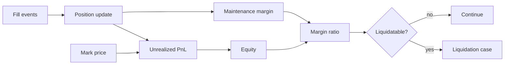

# 09 — Futures and Margin Engine

---

## 1. Product definition

USDT-M perpetual futures are **linear** contracts:

- Quote and settlement asset: USDT.
- Quantity: base asset units (e.g. BTC).
- Contract size: 1 base unit for launch instruments; the `Multiplier` type
  supports non-unit sizes for future products.
- No expiry; positions persist until closed or liquidated.
- Periodic funding aligns the perpetual price with the index.

### 1.1 Instrument parameters

| Parameter | Example (BTCUSDT) |
|-----------|-------------------|
| Tick size | 0.1 USDT |
| Lot size | 0.001 BTC |
| Min quantity | 0.001 BTC |
| Min notional | 5 USDT |
| Max leverage | 125x |
| Maintenance margin rate | Tiered, 0.4%–50% |
| Funding interval | 8 hours |
| Funding cap | ±0.75% per interval |
| Liquidation fee | 0.5% of notional |

### 1.2 Units and precision

| Value | Unit | Precision |
|-------|------|-----------|
| Price | ticks | Integer |
| Quantity | lots | Integer |
| Notional | USDT atomic units | 6 decimals |
| PnL | USDT atomic units | 6 decimals |
| Fees | USDT atomic units | 6 decimals |
| Funding rate | basis points | Integer (1 bp = 0.01%) |
| Margin ratio | basis points | Integer |

All intermediate calculations use exact integer or rational arithmetic. See
[15-precision-atomicity-idempotency.md](15-precision-atomicity-idempotency.md).

---

## 2. Position model

### 2.1 One-way mode

A single net position per `(account, symbol)`:

```rust
struct NetPosition {
    signed_qty: i64,        // positive long, negative short, zero flat
    entry_price: Price,
    realized_pnl: Amount,
    margin_mode: MarginMode,
    leverage: u16,
    isolated_margin: Amount,
}
```

- Buying increases the net position; selling decreases it.
- Crossing zero flips the position: the closed portion realizes PnL at the fill
  price, and the residual opens at the fill price.
- Reduce-only orders cannot flip.

### 2.2 Hedge mode

Two independent positions per `(account, symbol)`:

```rust
struct HedgePositions {
    long: Option<Position>,
    short: Option<Position>,
}
```

- A buy order with `position_side = Long` opens/increases the long.
- A sell with `position_side = Short` opens/increases the short.
- A sell with `position_side = Long` reduces the long.
- A buy with `position_side = Short` reduces the short.
- Long and short can coexist; margin is the sum of both sides' requirements.
- Reduce-only orders apply to the specified side.

### 2.3 Position mode changes

Allowed only when:

- No open orders for the symbol.
- No open positions for the symbol (both sides in hedge mode).
- No pending funding or liquidation for the account/symbol.

The change is a command with an audit event and takes effect at the next
sequence.

---

## 3. Entry price and realized PnL

### 3.1 Increasing a position

For a fill of `q` at price `p` that increases the position:

```
new_entry = (old_qty * old_entry + q * p) / (old_qty + q)
```

The result is rounded to the nearest tick, half-up. The rounding difference is
tracked in the position's `entry_rounding` accumulator and applied when the
position closes, so total realized PnL remains exact.

### 3.2 Reducing a position

For a fill of `q` at price `p` that reduces a long:

```
realized_pnl += q * (p - entry)
```

For a short:

```
realized_pnl += q * (entry - p)
```

The entry price does not change on a reduction. Fees are deducted separately
from the wallet.

### 3.3 Flipping a position (one-way)

For a sell of `q` against a long of `L`:

- Closed quantity: `min(q, L)`; realize PnL against the old entry.
- Residual: `q - L`; open a short at the fill price `p`.
- If `q < L`, the long remains with reduced quantity and unchanged entry.
- If `q = L`, the position is flat and entry resets.
- If `q > L`, the new short's entry is `p`.

### 3.4 Fees

- Taker fee: `notional * taker_fee_bps / 10_000`.
- Maker fee: `notional * maker_fee_bps / 10_000`.
- Fees are rounded **up** to the USDT atomic unit.
- Fees are debited from the futures wallet at settlement.
- A fee that would make the wallet negative triggers a margin check; if the
  account is below maintenance, liquidation follows.

### 3.5 Funding

Funding is applied to the position notional at the mark price at the funding
timestamp:

```
payment = position_notional * funding_rate
```

- Positive rate: longs pay, shorts receive.
- Negative rate: shorts pay, longs receive.
- Payment is rounded half-up; residue goes to the insurance fund.
- Funding does not change the entry price.
- Funding is applied even if the position is in liquidation, provided it was
  open at the funding timestamp.

---

## 4. Wallet, equity, and margin

### 4.1 Wallet balance

`wallet_balance` is the posted USDT balance of the user's futures ledger
account. It includes realized PnL and fees, and excludes unrealized PnL.

### 4.2 Unrealized PnL

For a long:

```
uPnL = qty * (mark_price - entry_price)
```

For a short:

```
uPnL = qty * (entry_price - mark_price)
```

Using mark price, not last price, prevents manipulation and ensures consistent
liquidation decisions.

### 4.3 Equity

Let `wallet_balance` be the total posted USDT in the futures wallet and
`isolated_margin_total` the sum of margin allocated to isolated positions.

**Cross margin:**

```
cross_equity = wallet_balance - isolated_margin_total
             + sum(uPnL of all cross positions)
```

**Isolated margin (per position):**

```
equity_i = isolated_margin_i + uPnL_i
```

The rest of the wallet is not available to an isolated position, and isolated
margin is excluded from cross equity so the same USDT is never counted twice.

### 4.4 Initial margin

```
IM = notional / leverage
notional = qty * mark_price
```

With tiered leverage, the maximum leverage depends on the position notional:

| Tier | Notional (USDT) | Max leverage | MMR |
|------|-----------------|--------------|-----|
| 1 | 0 – 50,000 | 125x | 0.40% |
| 2 | 50,000 – 250,000 | 100x | 0.50% |
| 3 | 250,000 – 1,000,000 | 50x | 1.00% |
| 4 | 1,000,000 – 5,000,000 | 20x | 2.50% |
| 5 | 5,000,000 – 20,000,000 | 10x | 5.00% |
| 6 | 20,000,000 – 50,000,000 | 5x | 10.00% |
| 7 | > 50,000,000 | 3x | 20.00% |

Tier selection uses the **higher** of the current position notional and the
post-order notional, preventing leverage arbitrage at boundaries. A position
that crosses into a higher tier must meet the new initial margin or be rejected.

### 4.5 Maintenance margin

```
MM = notional * mmr - maintenance_amount
```

`maintenance_amount` is derived so that `MM` is continuous at tier boundaries:

```
maintenance_amount_i = notional_floor_i * (mmr_i - mmr_{i-1}) + maintenance_amount_{i-1}
```

This yields a non-decreasing maintenance requirement and avoids a cliff that
would allow a position to be liquidated immediately after entering a new tier.

### 4.6 Margin ratio

**Cross:**

```
margin_ratio = MM_total / equity
```

Liquidation is triggered when `margin_ratio >= 1` (equity ≤ maintenance).

**Isolated:**

```
margin_ratio_i = MM_i / equity_i
```

### 4.7 Available margin

**Cross:**

```
available = cross_equity
          - IM_cross_total
          - pending_order_initial_margin
          - fee_buffer
```

**Isolated:**

```
available_i = isolated_margin_i - IM_i - fee_buffer
```

A new order is accepted only if its incremental initial margin and fee buffer
fit within available margin. Pending orders reserve margin at their limit price
(or mark price for market orders) plus a slippage buffer.

### 4.8 Margin ratio examples

Example 1 — cross, one long:

- Wallet: 10,000 USDT.
- Long 0.1 BTC at 60,000; mark 60,000; notional 6,000; leverage 10x.
- IM = 600; tier 1 MMR 0.40% → MM = 24.
- uPnL = 0; equity = 10,000.
- Margin ratio = 24 / 10,000 = 0.24%.
- Available = 10,000 − 600 − fee buffer ≈ 9,395.

Example 2 — price falls to 54,000:

- uPnL = 0.1 × (54,000 − 60,000) = −600.
- Equity = 9,400.
- MM = 0.1 × 54,000 × 0.004 = 21.6.
- Margin ratio = 21.6 / 9,400 = 0.23%. Far from liquidation.

Example 3 — 100x long, price falls 0.8%:

- Wallet 1,000; long 1 BTC at 60,000; notional 60,000; IM 600 (100x).
- Notional is in tier 2 (50k–250k), so MMR is 0.50%.
- Price 59,520; uPnL = −480; equity = 520.
- MM = 59,520 × 0.005 = 297.60.
- Margin ratio = 297.60 / 520 = 57.2%.
- Price 59,300; uPnL = −700; equity = 300; MM = 296.50; ratio = 98.8%.
- Price ~59,295; uPnL ≈ −705; equity ≈ 295; MM ≈ 296.5; ratio ≥ 100% →
  liquidation.

---

## 5. Liquidation price

### 5.1 Isolated long

Set equity equal to maintenance:

```
margin + qty * (P - entry) = qty * P * mmr - cum
```

Solve:

```
P_liq = (qty * entry - margin - cum) / (qty * (1 - mmr))
```

### 5.2 Isolated short

```
margin + qty * (entry - P) = qty * P * mmr - cum
```

Solve:

```
P_liq = (margin + qty * entry + cum) / (qty * (1 + mmr))
```

### 5.3 Fees and buffers

The effective margin used in the formulas is:

```
margin_eff = isolated_margin - expected_liquidation_fee - funding_buffer
```

If `margin_eff <= 0`, the position is immediately liquidatable. The expected
liquidation fee is `notional_at_liq * liquidation_fee_bps / 10_000`, solved
iteratively (two iterations are sufficient because the fee is small); the
result is rounded conservatively toward earlier liquidation.

### 5.4 Cross margin

Cross liquidation depends on all positions and the wallet balance. There is no
closed-form solution for a multi-position account because each position's
maintenance requirement depends on the same price but with different
directions.

Algorithm:

1. Build the piecewise-linear function `equity(P)`:
   `wallet + sum(signed_qty_i * (P - entry_i))`.
2. Build `MM(P) = sum(qty_i * P * mmr_i - cum_i)` using each position's tier at
   `P`; tier boundaries introduce breakpoints.
3. Solve `equity(P) = MM(P)` by evaluating all breakpoints and using bisection
   on each monotonic segment.
4. Choose the solution closest to the current mark price in the adverse
   direction.
5. If no solution exists above zero, the account is liquidatable at any price;
   liquidate immediately.

The result is recomputed on every mark price update and cached. It is a risk
indicator, not a guarantee; liquidation is always triggered by the actual
equity/margin check.

### 5.5 Bankruptcy price

The price at which equity is zero:

```
Long:  P_bankrupt = entry - margin / qty
Short: P_bankrupt = entry + margin / qty
```

The bankruptcy price is used to size the liquidation order and to determine the
deficit transferred to the insurance fund. It is not shown as the user's
liquidation price, which is earlier due to maintenance margin and fees.

### 5.6 Worked example

Long 1 BTC at 60,000, isolated margin 6,000, 10x, MMR 0.5%, no cum:

```
P_liq = (1*60,000 - 6,000) / (1 * (1 - 0.005))
      = 54,000 / 0.995
      = 54,271.36
```

With a 0.5% liquidation fee (≈271 USDT at that price), effective margin is
5,729, and:

```
P_liq = (60,000 - 5,729) / 0.995 ≈ 54,544
```

The exchange liquidates before the theoretical bankruptcy price, leaving a
buffer for slippage and fees.

---

## 6. Margin modes

### 6.1 Cross margin

- All cross positions share the futures wallet.
- Profits on one position can support losses on another.
- The account is liquidated as a whole when account equity ≤ total maintenance.
- New positions use the account's default margin mode unless overridden.

### 6.2 Isolated margin

- Each position has its own margin allocation.
- Losses are capped at the isolated margin; the rest of the wallet is protected.
- The user can add or remove margin (subject to initial margin requirements).
- Removing margin is rejected if it would push the position below initial
  margin or above the liquidation threshold.
- Liquidation of one isolated position does not affect others.

### 6.3 Switching modes

- Cross → isolated: requires sufficient free margin to allocate; the allocation
  is explicit.
- Isolated → cross: releases the isolated margin to the wallet, then recomputes
  cross requirements.
- Switching while positions are open is allowed only if the resulting margin
  ratio is safe (e.g. < 50% of maintenance) and no liquidation is in progress.
- Every switch is an audited command with before/after margin.

---

## 7. Leverage

- Leverage is set per symbol (isolated) or per account (cross default).
- Range: 1x to the instrument's maximum.
- Changing leverage recomputes initial margin; if the new requirement exceeds
  available margin, the change is rejected.
- Leverage applies to new and existing positions; existing positions may need
  additional margin after an increase.
- Maximum leverage is reduced in stressed markets by risk policy (e.g. halved
  during a volatility event), with announcement and a grace period for existing
  positions.

---

## 8. Position limits and risk tiers

| Limit | Scope | Enforcement |
|-------|-------|-------------|
| Max position notional | Account/symbol | Pre-trade |
| Max account notional | Account | Pre-trade |
| Max symbol open interest | Symbol | Pre-trade and circuit breaker |
| Max leverage | Account/symbol | Pre-trade |
| Max order size | Order | Pre-trade |
| Concentration limit | Account | Post-trade monitoring |

When a limit is reached:

- Risk-increasing orders are rejected.
- Reduce-only orders remain allowed.
- Existing positions are not forcibly reduced unless risk policy requires it
  (e.g. open interest cap breach triggers a reduction auction).

---

## 9. Position accounting examples

### 9.1 Increase

Long 0.1 BTC at 60,000, then 0.1 BTC at 61,000:

```
entry = (0.1*60,000 + 0.1*61,000) / 0.2 = 60,500
qty = 0.2
```

### 9.2 Partial close

Close 0.05 BTC at 62,000:

```
realized = 0.05 * (62,000 - 60,500) = 75 USDT
remaining qty = 0.15, entry = 60,500
```

### 9.3 Flip (one-way)

Long 0.1 at 60,000; sell 0.15 at 59,000:

```
closed 0.1: realized = 0.1 * (59,000 - 60,000) = -100 USDT
residual short 0.05 at 59,000
```

### 9.4 Hedge mode

Long 0.1 at 60,000 and short 0.05 at 61,000:

- Two positions, two margin requirements.
- PnL is computed independently.
- Closing the long does not affect the short.

---

## 10. Margin engine interfaces

```rust
pub trait MarginModel {
    fn initial_margin(&self, position: &Position, price: Price) -> Amount;
    fn maintenance_margin(&self, position: &Position, price: Price) -> Amount;
    fn unrealized_pnl(&self, position: &Position, price: Price) -> Amount;
    fn equity(&self, account: &MarginAccount, positions: &[Position], price: Price) -> Amount;
    fn available_margin(&self, account: &MarginAccount, positions: &[Position], price: Price) -> Amount;
    fn liquidation_price(&self, account: &MarginAccount, positions: &[Position]) -> Option<Price>;
    fn bankruptcy_price(&self, position: &Position) -> Option<Price>;
}
```

Implementations:

- `CrossMarginModel`
- `IsolatedMarginModel`

Both are pure and deterministic. They are tested against a reference
implementation and property tests:

- Increasing position size never decreases initial or maintenance margin.
- Increasing leverage never increases initial margin.
- Equity is monotonic in price for a long and decreasing for a short.
- Liquidation price for a long is below entry; for a short, above entry.
- A position with zero quantity has zero margin and no liquidation price.
- `available_margin <= equity`.

---

## 11. Risk data flow



Position updates and mark price updates are ordered per account. A stale mark
price cannot trigger liquidation; the risk engine rejects marks older than the
configured threshold.

---

## 12. Reconciliation

Nightly:

1. Replay all fills for each account/symbol and compare quantity, entry price,
   and realized PnL.
2. Recompute margin components at the latest mark and compare the cache.
3. Verify isolated margin allocations sum to the wallet balance minus cross
   collateral.
4. Verify no position exists without a corresponding non-zero ledger balance or
   margin allocation.
5. Verify realized PnL plus fees plus funding equals the change in wallet
   balance for closed positions.

Mismatches freeze the affected account's withdrawals and risk-increasing
orders until resolved.
