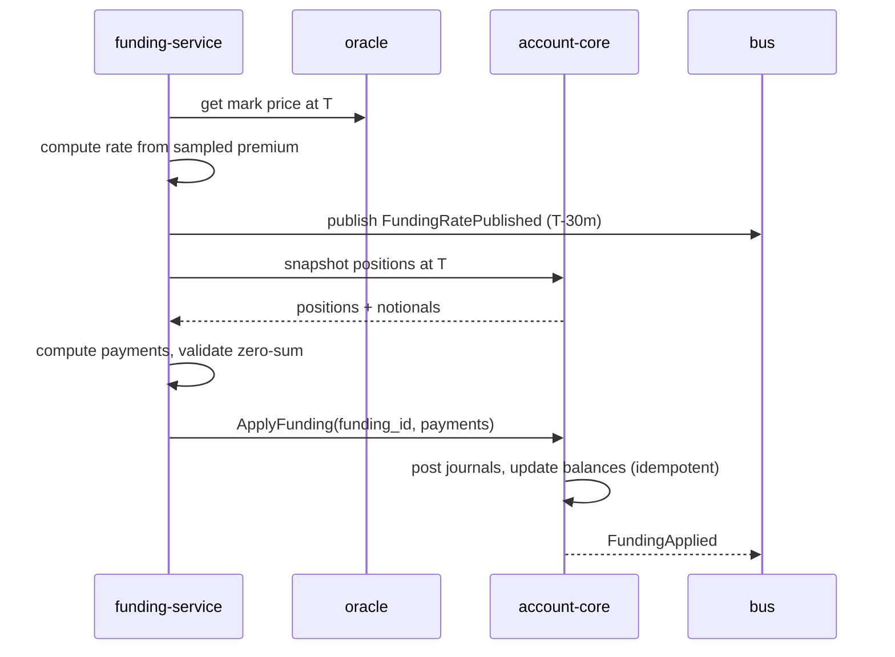
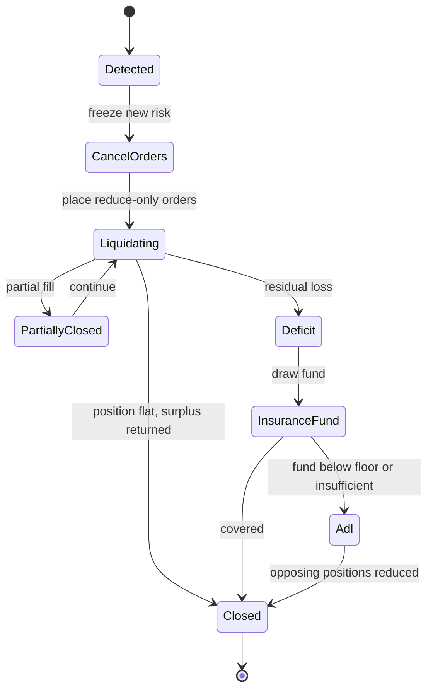

# 10 — Funding, Liquidation, Insurance Fund and ADL

---

## 1. Price inputs

### 1.1 Index price

The index price is the exchange's reference for the spot value of the base
asset. It is produced by `oracle-service` from multiple external venues.

Algorithm:

1. Collect last-trade or mid prices from at least 3 reputable venues.
2. Discard stale observations (older than 5 seconds) and outliers deviating
   more than 2% from the median.
3. Compute the median of the remaining observations.
4. Compute the volume-weighted median if volume data is available and fresh.
5. Reject the update if fewer than 2 venues remain.
6. Publish with `as_of`, `sources`, and a confidence score.

Guards:

- Maximum change per update: 1% (unless a market-wide circuit breaker allows
  more).
- Staleness: if the index is older than 10 seconds, mark price freezes and
  risk-increasing orders are rejected.
- Divergence: if the index deviates from the last mark by more than 5%, trigger
  a review and widen bands; do not liquidate on a single anomalous print.

### 1.2 Mark price

Mark price is the fair value used for PnL, margin, funding, and liquidation.

```
premium = (impact_bid + impact_ask) / (2 * index) - 1
mark_raw = index * (1 + premium)
mark = EMA(mark_raw, alpha) clamped to [index * (1 - band), index * (1 + band)]
```

Where:

- `impact_bid` / `impact_ask` are the average execution prices for a configured
  notional (e.g. 10,000 USDT) on each side of the book.
- If the book is too thin, use the index plus the last valid basis.
- `alpha` corresponds to a 1-minute half-life.
- `band` is instrument-specific (default ±5%, tighter for stable pairs).
- The mark is published every second and on every significant book change.

Mark price must be:

- Monotonic within a batch (no oscillation within one update).
- Resistant to single-print manipulation (uses impact prices, not last trade).
- Frozen, not extrapolated, when inputs are stale.

### 1.3 Last price vs. mark price

| Use | Price |
|-----|-------|
| PnL, margin, liquidation, funding | Mark |
| Trigger evaluation (configurable) | Last or mark |
| Display | Last |
| Limit order price band | Mark or last, per instrument |

Liquidation never uses last price alone.

---

## 2. Funding

### 2.1 Purpose

Funding transfers value between longs and shorts to keep the perpetual price
close to the index. It is not a fee; the exchange does not take a cut (except
rounding residue to the insurance fund).

### 2.2 Schedule

- Interval: 8 hours by default (00:00, 08:00, 16:00 UTC).
- Sampling: premium is sampled every 5 seconds and time-weighted over the
  interval.
- Publication: the rate is published at least 30 minutes before application.
- Application: at the interval boundary, using the mark price at that timestamp.
- Positions opened after the snapshot do not pay; positions closed before it do
  not pay.

### 2.3 Rate formula

```
P = time_weighted_premium_index
I = interest_rate (default 0.01% per 8h)
F = P + clamp(I - P, -0.05%, +0.05%)
F = clamp(F, -cap, +cap)
```

- `cap` is instrument-specific (default 0.75% per interval).
- The interest component prevents persistent negative funding in flat markets.
- The clamp on `I - P` limits the influence of the fixed interest rate.
- The final clamp protects against manipulation and extreme markets.

### 2.4 Payment

For each position open at the funding timestamp:

```
notional = qty * mark_price
payment = notional * F
```

- `F > 0`: longs pay, shorts receive.
- `F < 0`: shorts pay, longs receive.
- Payment is rounded half-up to the USDT atomic unit.
- The sum of all payments must be zero except for rounding residue, which is
  posted to the insurance fund.
- A position with zero quantity pays nothing.
- In hedge mode, long and short positions are funded separately.

### 2.5 Example

- BTCUSDT mark price at funding: 60,000.
- Long 0.5 BTC, short 0.5 BTC.
- Funding rate: +0.01% (1 bp).
- Long notional: 30,000; payment: −3 USDT.
- Short notional: 30,000; payment: +3 USDT.
- Insurance fund receives 0 (no rounding residue).

With a rate of +0.75% (cap), the long pays 225 USDT and the short receives 225.

### 2.6 Funding batch lifecycle



Failure handling:

- If the mark price is stale at T, delay application and retry; do not use an
  old rate silently.
- If position snapshots disagree with account-core at application time, reject
  the batch (`STALE_SNAPSHOT`) and recompute.
- A partially applied batch is impossible: each position is idempotent, and the
  batch is retried until complete.
- If a position is liquidated between snapshot and application, apply funding to
  the position as it existed at T; account-core resolves the historical state.

### 2.7 Funding and liquidation

- Funding is applied before liquidation checks at the interval boundary.
- A funding payment that pushes an account below maintenance triggers
  liquidation in the same risk cycle.
- Funding is not skipped for accounts in liquidation if the position was open at
  T.

---

## 3. Liquidation overview

Liquidation protects the exchange from losses when a trader's equity falls below
the maintenance requirement. The process is deterministic, auditable, and
resumable.

### 3.1 Triggers

| Trigger | Condition |
|---------|-----------|
| Margin breach | `equity <= maintenance_margin` (cross) or `equity_i <= MM_i` (isolated) |
| Negative wallet | Wallet balance below zero after fees/funding |
| Risk policy | Leverage tier breach, position limit breach with no reduction |
| Oracle emergency | Mark price frozen too long with adverse exposure |
| Manual | Risk operator force-liquidation (audited) |

A liquidation is triggered by mark price, never by a single last trade.

### 3.2 Detection loop

- `risk-engine` evaluates all accounts with open positions on every mark price
  update and at least once per second.
- Accounts are partitioned by account shard for parallelism.
- Evaluations are idempotent; a case is created at most once per
  `(account, symbol, position_side, trigger_epoch)`.
- A case is cancelled if the account restores margin before execution begins.

### 3.3 Case state machine



Each transition writes a `LiquidationEvent` and is idempotent. A case can resume
after a crash from its last persisted state.

---

## 4. Liquidation execution

### 4.1 Step 1 — Freeze

- Reject new risk-increasing orders for the account (or the isolated position).
- Allow reduce-only orders from the user; they improve the outcome.
- Cancel all open orders for the affected symbol(s) to release margin and avoid
  conflicting fills.
- In cross mode, cancel all orders across all symbols because collateral is
  shared.

### 4.2 Step 2 — Plan

The risk engine computes:

- Position size and side.
- Mark price, bankruptcy price, and liquidation price.
- Expected deficit at bankruptcy.
- Book depth and expected slippage.
- Whether to liquidate partially or fully.
- Whether the insurance fund can absorb the expected deficit.

### 4.3 Step 3 — Liquidate

Liquidation orders are:

- Reduce-only, IOC or short-TTL limit orders.
- Priced at or slightly better than the bankruptcy price, adjusted for fees and
  a slippage buffer.
- Sized to the position, or partially sized when the position exceeds a
  percentage of visible depth (default 10%) to avoid moving the market
  excessively.
- Repeated in tranches until flat or until the case transitions to deficit.

Example (long 10 BTC, bankruptcy 57,000, best bid 57,200):

1. Place sell 10 BTC at 57,050, IOC.
2. Filled 6 BTC at 57,150; remaining 4 BTC.
3. Re-evaluate; place sell 4 BTC at 57,020.
4. Filled 3 BTC; remaining 1 BTC with no bids above 56,900.
5. The remaining position is closed by the backstop at 56,900.
6. Deficit is computed and covered by the insurance fund.

### 4.4 Step 4 — Deficit

After closing:

```
remaining_margin = isolated_margin + realized_pnl - fees
deficit = max(0, -remaining_margin)
surplus = max(0, remaining_margin)
```

- Surplus is returned to the user's wallet (isolated) or remains in the cross
  wallet.
- Deficit is drawn from the insurance fund.
- If the fund is insufficient, ADL is triggered.
- A customer balance is never left negative; any residual is covered by the
  waterfall.

### 4.5 Step 5 — Unfreeze

- Remove the liquidation flag.
- Allow trading if the account is healthy and no compliance restriction applies.
- Emit a notification with the case ID, fills, fees, and outcome.
- Update risk dashboards and the audit log.

### 4.6 Liquidation fees

- A liquidation fee (default 0.5% of liquidated notional) is charged to the
  liquidated account.
- The fee goes to the insurance fund.
- The fee is included in the liquidation price calculation so the account is
  liquidated before equity is exhausted.
- Fee waivers require risk-committee approval and are audited.

---

## 5. Insurance fund

### 5.1 Purpose

The insurance fund absorbs losses when a liquidated position cannot be closed
at a price that preserves the exchange's solvency. It is segregated from
customer funds and from operating capital.

### 5.2 Sources

| Source | Frequency |
|--------|-----------|
| Seed capital | At launch |
| Liquidation fees | Per liquidation |
| Funding rounding residue | Per funding interval |
| ADL residue | Per ADL event |
| Voluntary contributions | Governance |
| Investment income | Policy-dependent, conservative |

### 5.3 Uses

- Cover liquidation deficits.
- Cover negative balances after a force majeure event (with governance).
- Never used for operating expenses, marketing, or customer withdrawals outside
  a documented deficit.

### 5.4 Ledger representation

- A dedicated `SYSTEM_INSURANCE` account per asset (USDT at launch).
- Balance is derived from the ledger, not a counter.
- Drawdowns and contributions are journal batches with `case_id` references.
- A separate `insurance_fund_ledger` table provides an audit trail.
- Daily reporting: balance, inflows, outflows, coverage ratio, largest
  exposures.

### 5.5 Policy parameters

| Parameter | Default | Governance |
|-----------|---------|------------|
| Target size | 2% of open interest | Risk committee |
| Floor | 0.5% of open interest | Risk committee |
| Max drawdown per event | 20% of fund | CEO + risk lead |
| Replenishment rate | 20% of liquidation fees | Risk committee |
| Investment policy | Cash/stablecoin only | Treasury |

When the fund falls below the floor:

- Increase the share of liquidation fees retained.
- Reduce maximum leverage for new positions.
- Enable ADL readiness.
- Publish a status notice if required by policy.

### 5.6 Coverage ratio

```
coverage = insurance_fund_balance / expected_worst_case_deficit
```

`expected_worst_case_deficit` is computed from stress scenarios (e.g. a 20%
adverse move over 1 hour across all positions). A ratio below 1.0 triggers risk
review; below 0.5 triggers leverage reduction and ADL readiness.

---

## 6. Auto-deleveraging (ADL)

### 6.1 When ADL runs

ADL is a last resort, used only when:

1. A liquidation produces a deficit, and
2. The insurance fund is below its floor or insufficient for the deficit, and
3. The backstop cannot close the position at an acceptable price.

ADL is never used to manage ordinary volatility or to protect profits.

### 6.2 Principles

- Opposing profitable positions are reduced at the bankrupted position's
  bankruptcy price.
- Selection is deterministic and published in advance.
- Users can see their ADL ranking (queue indicator 0–4) in real time.
- ADL is pro-rata within the selected rank, capped per event.
- All actions are journaled, notified, and auditable.

### 6.3 Ranking

For each opposing position:

```
profit_ratio = uPnL / initial_margin
score = profit_ratio * effective_leverage
```

- Higher score = higher priority.
- Tie-breakers: larger position notional, then older position, then lower
  account ID (deterministic).
- Only positions on the opposite side and same symbol are eligible.
- Reduce-only orders and positions in liquidation are excluded.
- Positions with pending withdrawals are not excluded; ADL takes precedence.

### 6.4 Queue indicator

| Indicator | Meaning |
|-----------|---------|
| 0 | Lowest priority (low profit, low leverage) |
| 1 | Below median |
| 2 | Above median |
| 3 | High priority |
| 4 | Highest priority (next to be deleveraged) |

The indicator is recomputed on every mark price update and shown in the private
stream.

### 6.5 Execution

1. Determine the quantity to deleverage: enough to cover the deficit, capped at
   the eligible opposing open interest.
2. Select positions by rank until the required quantity is covered.
3. Execute at the bankrupted position's bankruptcy price:
   - The profitable trader's position is reduced.
   - Realized PnL is transferred from the trader to the clearing account.
   - The liquidated position is closed against the same notional.
4. Charge an ADL fee? No. ADL is a risk action, not a service.
5. Emit `AdlExecuted` with the ranking snapshot and fills.
6. Update queue indicators.

### 6.6 Example

- Liquidated long 10 BTC at bankruptcy 57,000; deficit 50,000 USDT.
- Insurance fund balance: 20,000 USDT; floor: 30,000.
- Eligible shorts: A (2 BTC, score 8.1), B (5 BTC, score 6.4), C (3 BTC, score
  4.2).
- Remaining deficit after the fund: 30,000 USDT → 0.526 BTC at 57,000, plus a
  buffer → 0.6 BTC.
- ADL reduces A by 0.6 BTC at 57,000; A realizes profit, the liquidated long is
  closed.
- Deficit after fund and ADL: 0; the fund remains at 20,000 (below floor) and
  leverage is reduced.

### 6.7 Fairness and transparency

- Ranking formula and current indicator are documented publicly.
- ADL events are published in aggregate (symbol, quantity, price, time) without
  identifying users.
- A user can query their ADL history and queue indicator.
- Disputes are handled through support with the case ID.

### 6.8 Socialized loss

If ADL cannot cover the deficit (e.g. no opposing positions), the remaining loss
may be socialized across profitable positions or all users in the symbol,
subject to:

- Governance approval.
- Public disclosure.
- A documented allocation formula (pro-rata to profit or position size).
- Legal and regulatory review.

Socialized loss is a last resort and is disabled by default at launch. The
system halts the symbol before reaching this state if policy requires.

---

## 7. Backstop liquidity

The exchange may maintain a **backstop account** that takes over residual
positions at the bankruptcy price when the book is insufficient.

- The backstop is a system account with defined capital and limits.
- It is used before the insurance fund and ADL.
- Its PnL is reported separately.
- It cannot front-run customer orders; it only participates when a liquidation
  order would otherwise remain unfilled.
- Backstop participation is visible in market data as a special trade flag.

---

## 8. Liquidation and ADL failure handling

| Failure | Behavior |
|---------|----------|
| Mark price stale | Freeze new risk; pause liquidation until a valid mark or use last good with a widened buffer and manual approval |
| Book empty | Use backstop; if unavailable, ADL |
| Partial fill | Re-plan and continue; never abandon a case |
| Account-core timeout | Retry idempotently; do not place duplicate orders |
| Trading core unavailable | Queue the case; halt the symbol if exposure is material |
| Insurance fund insufficient | ADL; if still insufficient, halt and escalate |
| ADL ranking changes mid-execution | Use the snapshot taken at case start; do not re-rank partially |
| Duplicate case | Deduplicate by case key; return existing state |
| Oracle divergence | Halt symbol; do not liquidate on a manipulated mark |

Every failure path preserves the invariant: no customer balance goes negative,
and every deficit is accounted for.

---

## 9. Risk cycle ordering

At each mark price update, the risk engine processes events in this order:

1. Apply oracle/mark update.
2. Apply funding if at an interval boundary.
3. Update unrealized PnL and margin for affected accounts.
4. Detect liquidations.
5. Execute liquidation plans (cancel orders, place reduce-only orders).
6. Settle fills.
7. Recompute deficits; draw insurance fund or ADL.
8. Update queue indicators.
9. Publish risk events.

Ordering is deterministic per account shard. Cross-account actions (ADL) use a
global deterministic ranking over a consistent snapshot.

---

## 10. Observability

Metrics:

- Funding rate, premium index, mark-index basis, per symbol.
- Insurance fund balance, coverage ratio, inflows/outflows.
- Liquidation count, notional, deficit, duration, slippage.
- ADL count, notional, rank distribution.
- Accounts above 80% margin ratio (early warning).
- Oracle staleness and venue disagreement.
- Settlement lag for liquidation fills.

Alerts:

- Insurance fund below floor.
- Liquidation case open > 5 minutes.
- Deficit > threshold.
- ADL executed.
- Mark/index divergence > 3%.
- Funding batch late or unbalanced.

---

## 11. Governance and audit

- Parameter changes (MMR, leverage, funding cap, liquidation fee) require a
  risk-committee decision, an ADR, and a public notice period.
- Every liquidation and ADL has a case ID linking oracle prices, positions,
  orders, fills, journals, and notifications.
- Cases are retained for at least 7 years.
- Regulators can export case data through the back office with access controls.
- Post-incident reviews are mandatory for any deficit above the configured
  threshold.
