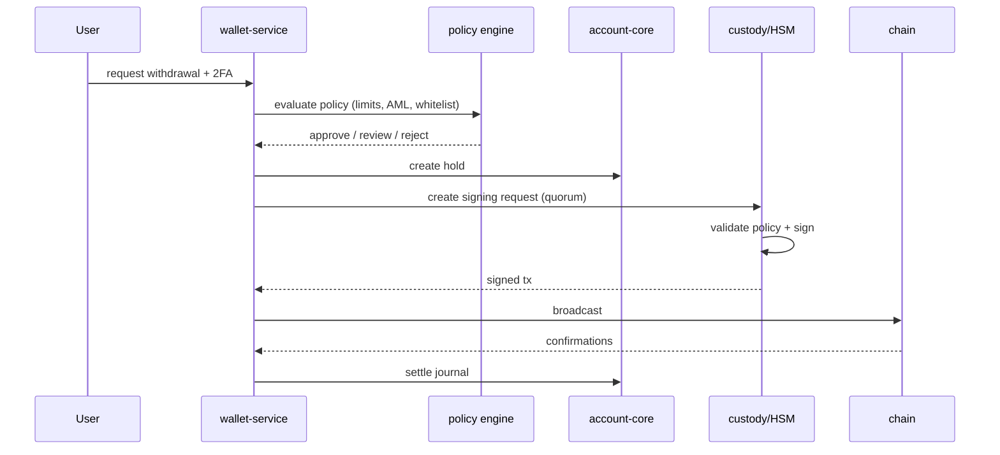

# 14 — Custody and Key Management

---

## 1. Custody model

NEXORA uses a **tiered custody model** with a qualified custodian and/or
self-managed HSM/MPC infrastructure. Customer assets are segregated from
operating funds and from the insurance fund.

| Tier | Share of assets | Access | Signing | Use |
|------|-----------------|--------|---------|-----|
| Hot | 2–5% | Online | 2-of-3 MPC or HSM | Automated withdrawals, sweeps |
| Warm | 10–15% | Semi-online | 3-of-5 with manual approval | Rebalancing |
| Cold | 80–88% | Offline | 3-of-5 geographically distributed | Long-term storage |
| Insurance | Policy | Offline | 3-of-5 + governance | Deficit coverage only |

Percentages are targets, reviewed weekly and after large flows. Hot wallet
balances are capped per asset and network; exceeding the cap triggers a sweep to
warm/cold.

### 1.1 Segregation

- Customer assets are held in dedicated custody wallets, not commingled with
  operating capital.
- The insurance fund has its own wallet/account and ledger account.
- Fee revenue is swept to a treasury wallet on a schedule.
- Custody addresses are labeled and reconciled daily.

---

## 2. Key management

### 2.1 HSM

- FIPS 140-3 Level 3 (or equivalent) HSMs in at least two data centers.
- Keys are generated inside the HSM and never exported in plaintext.
- Signing operations are logged with caller identity, transaction hash, and
  policy decision.
- HSM firmware is pinned, signed, and updated through a controlled process.
- HSMs are connected only to dedicated signer hosts on an isolated network.

### 2.2 MPC

If an MPC custody provider is used:

- Key shares are held by independent parties (exchange, custodian, recovery
  agent).
- Threshold: 2-of-3 for hot, 3-of-5 for cold.
- No single party can reconstruct the full key.
- Share refresh is performed quarterly and after personnel changes.
- Provider compromise is covered by contractual and technical controls.

### 2.3 Key hierarchy

```
Root key (HSM, offline ceremony)
  ├── Network master keys (per chain family)
  │     ├── Hot wallet keys (MPC/HSM)
  │     ├── Warm wallet keys (MPC)
  │     └── Cold wallet keys (offline shares)
  ├── Deposit derivation keys (xpub only online)
  └── Signing keys for API/auth (Ed25519, rotated)
```

- Deposit addresses are derived from an xpub; the private key is never needed
  online.
- Withdrawal signing uses the appropriate tier key.
- API/auth signing keys are separate from custody keys.

### 2.4 Key ceremony

- Conducted in a physically secure room with at least three authorized
  participants from different functions.
- Air-gapped hardware, tamper-evident bags, and video recording.
- Keys generated and split; shares distributed to geographically separate
  safes.
- Ceremony transcript signed by all participants and stored in the audit archive.
- Annual rehearsal and after any custodian change.

### 2.5 Backup and recovery

- Key shares are backed up in tamper-evident, geographically separated media.
- Backups are encrypted with keys held by separate officers.
- Recovery requires a quorum and a documented ceremony.
- Recovery drills are performed annually without moving customer funds.
- Lost shares are replaced through a re-share ceremony, not by reconstructing
  the old key.

### 2.6 Rotation and revocation

- Hot wallet keys rotate quarterly or on suspicion.
- API/auth keys rotate according to policy and on incident.
- Compromised keys are revoked immediately; funds are swept to a new address.
- Rotation events are recorded in the audit log and reflected in custody
  reconciliation.

---

## 3. Deposit architecture

### 3.1 Address generation

- HD wallets: BIP32/BIP44 derivation per user per network.
- MPC providers: address request through the provider API; mapping stored in
  `wallet.deposit_addresses`.
- Memo/tag chains: unique memo per user under a shared address.
- Addresses are generated on demand and cached.

### 3.2 Chain watchers

Each supported network has a watcher that:

- Subscribes to blocks and mempool (where appropriate).
- Parses transactions and token transfers.
- Normalizes to `(network, txid, vout, asset, amount, from, to, memo)`.
- Confirms depth and handles reorgs.
- Emits events to the wallet service.

Watchers are isolated per network; a failure on one chain does not affect
others. They run with read-only node credentials where possible.

### 3.3 Confirmations

| Network type | Default confirmations |
|--------------|-----------------------|
| Bitcoin | 3 |
| Ethereum | 12 |
| TRON | 19 |
| BSC | 15 |
| Solana | 32 (finalized) |
| Others | Per network risk assessment |

Confirmations are configurable and can be increased during chain congestion or
after an incident.

### 3.4 Reorg handling

- Deposits are credited only after the confirmation threshold.
- The watcher tracks block hashes and emits `Reorg` when a previously observed
  block is orphaned.
- If a credited deposit is reorged:
  - Reverse the journal if funds remain available.
  - Otherwise freeze the account and open a case.
- Withdrawals are not considered final until the confirmation threshold; a
  reorg after broadcast may require a replacement transaction.

---

## 4. Withdrawal architecture

### 4.1 Flow



### 4.2 Policy engine

Checks:

- User KYC level and jurisdiction.
- Asset/network enabled.
- Destination whitelisted (24-hour cool-off).
- Daily/monthly velocity limits.
- Amount vs. tier threshold.
- AML/sanctions score.
- Device/session risk.
- Unusual behavior (new address, new device, rapid changes).
- Withdrawal pause flags (chain incident, reconciliation failure).

Decisions: `AUTO_APPROVE`, `MANUAL_REVIEW`, `REJECT`.

### 4.3 Approval quorum

| Amount (USDT equivalent) | Approval |
|--------------------------|----------|
| < 10,000 | Automated |
| 10,000 – 100,000 | 1 risk operator |
| 100,000 – 1,000,000 | 2 approvers (risk + treasury) |
| > 1,000,000 | 3 approvers + HSM quorum |

Approvers cannot approve their own requests. All approvals are recorded with
identity, timestamp, and reason.

### 4.4 Signing policy

The HSM/MPC enforces:

- Destination is allowlisted or explicitly approved.
- Amount within the per-transaction and daily caps.
- Asset/network match.
- Transaction construction matches the approved intent (address, amount, fee).
- Quorum of key shares/HSM operators.
- No duplicate transaction hash.

The signer host never has internet access; it receives unsigned transactions
from the wallet service, validates them, and returns signatures.

### 4.5 Broadcast and confirmation

- Broadcast through multiple nodes/providers for redundancy.
- Track transaction hash, nonce, and fee.
- If stuck, replace with a higher fee (same nonce) or rebroadcast; never create a
  second transfer to the same destination for the same withdrawal.
- On confirmation, settle the ledger and notify the user.
- On permanent failure, release the hold and record the reason.

### 4.6 Gas and fee management

- Native gas balances are monitored per chain.
- Gas treasury is refilled from operating funds, not customer funds.
- Fee quotes include a buffer; unspent buffer is reconciled.
- EIP-1559 fee strategy with max fee and priority fee caps.
- Fee spikes pause non-urgent withdrawals.

---

## 5. Cold storage operations

- Cold keys are offline; signing requires a ceremony with quorum.
- Transactions are constructed on an online host, exported as unsigned
  payloads, signed offline, and broadcast by a separate host.
- The unsigned payload includes a human-readable summary and a cryptographic
  hash; signers verify both.
- Ceremonies are recorded, witnessed, and stored.
- Cold-to-hot transfers are scheduled and minimized; they are not used for
  routine customer withdrawals.
- Cold balances are reconciled weekly and after every ceremony.

---

## 6. Custody reconciliation

### 6.1 Daily reconciliation

```
on-chain balance per asset/network
  + deposits in flight
  - withdrawals in flight
  = custody ledger balance
```

Then:

```
customer liabilities + system balances = custody assets + receivables
```

Any shortfall is a Sev-1; withdrawals pause and the incident team is paged.

### 6.2 Address-level reconciliation

- Every custody address is labeled and mapped to a ledger account.
- Sweeps are recorded and reconciled.
- Unknown inflows are quarantined and investigated.
- Dust and fee balances are tracked separately.

### 6.3 Proof of reserves

- Daily snapshot of customer balances.
- Merkle tree with leaves `hash(account_id, asset, balance)`.
- Publish root, total liabilities, and custody addresses.
- Users can verify inclusion.
- Optional third-party attestation.
- Liabilities include spot, futures collateral, and pending withdrawals.

### 6.4 Audit

- External auditors review custody controls annually.
- SOC 2 Type II (or equivalent) for the custody provider.
- Penetration tests of the signing infrastructure.
- Key ceremony and access logs available to auditors.

---

## 7. Vendor and counterparty risk

- Custody providers must have SOC 2, insurance, and a proven incident history.
- Contracts include SLA, liability, audit rights, and exit provisions.
- Concentration limits per provider and per chain.
- Regular due diligence and financial health monitoring.
- Exit plan: ability to migrate keys/addresses within a defined window.
- No single provider holds a quorum of any key.

---

## 8. Disaster recovery for custody

| Scenario | Response |
|----------|----------|
| Hot wallet key compromise | Freeze withdrawals, sweep to new wallet, rotate keys, notify |
| HSM failure | Fail over to secondary HSM; restore from backup shares |
| Custodian outage | Use secondary provider or self-managed signer; pause withdrawals if quorum unavailable |
| Data center loss | Sign from secondary site with quorum |
| Key share loss | Re-share ceremony with remaining quorum |
| Chain halt/reorg | Pause affected network; monitor; resume after finality |
| Signer host compromise | Isolate, rotate keys, forensic review, sweep funds |

RTO for withdrawals: < 4 hours for a single-site failure; < 24 hours for a
custodian failure with an alternate signer. RPO: zero for signed transactions;
no customer funds are lost due to a signing outage.

---

## 9. Custody invariants

1. Customer funds are segregated from operating and insurance funds.
2. No single person or system can sign a withdrawal alone.
3. Private keys never exist in plaintext outside an HSM/MPC boundary.
4. Every signed transaction maps to an approved withdrawal intent.
5. No withdrawal is broadcast twice for the same request.
6. Hot wallet balances stay within policy caps.
7. Cold storage holds the majority of assets.
8. Every custody address is labeled and reconciled daily.
9. Reorgs are handled before final settlement.
10. Key ceremonies and recoveries are witnessed and audited.
