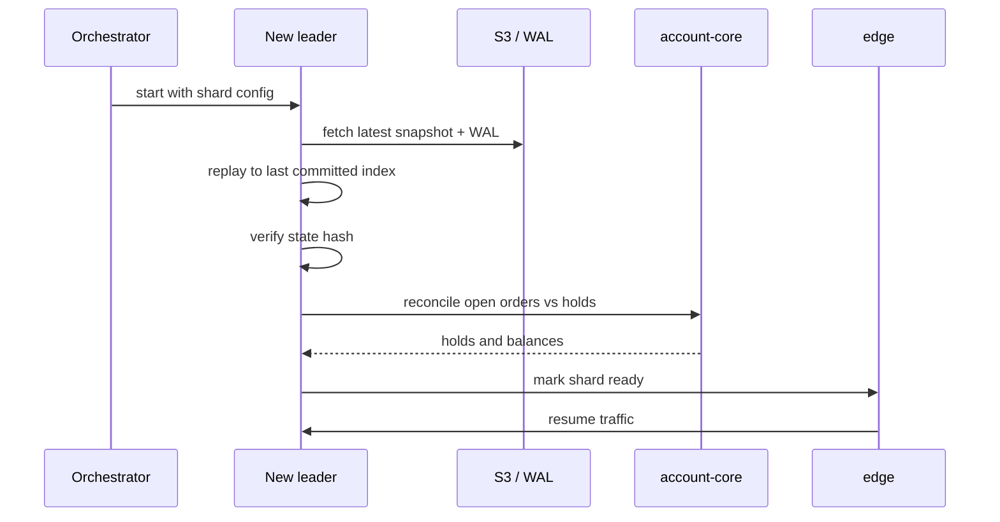

# 17 — Crash Recovery and Disaster Recovery

---

## 1. Failure taxonomy

| Class | Example | Scope | Data risk |
|-------|---------|-------|-----------|
| Process crash | Panic, OOM kill | One service instance | None if WAL committed |
| Node crash | Kernel panic, power loss | One host | None with replication |
| AZ failure | Network/power outage | One availability zone | Quorum survives |
| Database failover | Primary failure | One DB cluster | None with sync replica |
| Bus failure | Broker loss | One broker | None at RF=3 |
| Region failure | Natural disaster | Primary region | Up to 5 min of async replication |
| Logical corruption | Bad deploy, bug | Service or data | Requires restore/replay |
| Security incident | Key compromise | Platform | Requires containment and rotation |

The recovery design targets:

- **RPO 0** for commands acknowledged after quorum commit.
- **RTO < 30 s** for a trading shard leader failure.
- **RTO < 60 s** for an account shard leader failure.
- **RTO < 15 min** for a Postgres primary failover.
- **RTO < 4 h** for a full region failover; **RPO < 5 min**.

---

## 2. Trading core recovery

### 2.1 State

- In-memory order book and OMS.
- WAL segments on local NVMe.
- Raft log on local NVMe.
- Snapshots on local NVMe and S3.
- Durable projection in Postgres (asynchronous).

### 2.2 Crash scenarios

| Scenario | Recovery |
|----------|----------|
| Process crash, same node | Restart; replay WAL from last snapshot; verify hash; resume |
| Node loss, leader | Raft elects a follower with the longest log; replay committed entries; resume |
| Node loss, follower | Leader continues; replace follower; catch up via snapshot + log |
| Disk loss | Restore snapshot from S3 + replay archived WAL; rejoin as follower |
| Quorum loss | Symbol halts; no acknowledgements; restore quorum or fail over region |
| Torn WAL tail | CRC fails; truncate to last valid record; replay; verify hash |
| Snapshot corruption | Use previous snapshot; replay WAL; verify hash |

### 2.3 Recovery sequence

### 2.4 Fencing

- A leader that loses quorum MUST stop acknowledging within 2 seconds.
- The old leader's term is persisted; it cannot accept writes without a new
  quorum.
- Storage fencing tokens prevent a zombie leader from writing to shared
  resources.
- The edge stops routing to a shard when the leader's lease expires.

### 2.5 Reconciliation after recovery

1. Compare open orders in the book with holds in account-core.
2. Compare the last trade sequence with the settlement inbox.
3. Re-emit any missing trade events from the WAL (idempotent).
4. Verify no duplicate trades.
5. Resume only after both checks pass; otherwise halt and page.

---

## 3. Account core recovery

### 3.1 State

- In-memory balances, holds, positions, margin.
- WAL and Raft log.
- Journal and projections in Postgres (authoritative for audit, but WAL is the
  hot state).
- Snapshots.

### 3.2 Recovery

1. Restore the latest snapshot.
2. Replay WAL to the last committed index.
3. Verify per-account balances, holds, and positions.
4. Verify the hash chain.
5. Reconcile with Postgres journal (if Postgres is ahead, replay from the
   journal; if behind, rebuild from WAL).
6. Reconcile with trading-core open orders.
7. Resume.

### 3.3 Dual-source reconciliation

Account-core has two durable representations:

- WAL + snapshot (fast, authoritative for live state).
- Postgres journal (durable, queryable, auditable).

On recovery, compare:

- Last journal sequence in WAL vs. Postgres.
- Per-account posted balance.
- Hold totals.
- Position quantities.

If they differ:

- Prefer the journal for posted balances (it is the accounting source of truth).
- Rebuild holds and positions from the event stream.
- If the discrepancy cannot be explained, freeze the account and page.

---

## 4. Database recovery

### 4.1 Patroni failover

- Synchronous replica receives every commit (`synchronous_commit =
  remote_apply`).
- On primary failure, Patroni promotes the sync replica.
- Services reconnect with bounded retry and jitter.
- Fencing ensures the old primary cannot accept writes (STONITH or cloud
  isolation).
- Target RTO < 60 s; measured quarterly.

### 4.2 Point-in-time recovery

- Base backup daily; WAL archived continuously to S3.
- Restore to a new cluster, replay to a target timestamp.
- Validate with reconciliation queries before switching traffic.
- PITR is used for logical corruption, not for routine failover.

### 4.3 Logical corruption

Examples: bad migration, bug that double-credits, wrong fee schedule.

Procedure:

1. Halt the affected service or symbol.
2. Identify the first bad transaction (audit + journal).
3. Restore a copy to a point before the corruption.
4. Replay valid events after the point, excluding the bad ones.
5. Compute the correction journal (balanced, dual-approved).
6. Apply the correction in production with audit.
7. Verify reconciliation.
8. Post-incident review.

Never edit journal rows in place. Corrections are new balanced batches.

---

## 5. Event bus recovery

- RF=3 with `min.insync.replicas=2`.
- Producer `acks=all` and idempotence.
- Consumer offsets committed after the effect, in the inbox transaction.
- Broker loss: leaders re-elect; producers retry.
- Cluster loss: replay from the outbox and source WAL; consumers rebuild.
- Retention: financial topics 7–30 days; longer via tiered storage.
- Dead-letter topics retain full context for replay.

### 5.1 Outbox relay

- The outbox is written in the same transaction as the state change.
- A relay publishes unpublished rows in order and marks them published.
- If the relay crashes, it resumes from the last unpublished row.
- Consumers deduplicate by `event_id`, so duplicate publishes are safe.
- Outbox lag is a key metric; alert at 1 s p99.

---

## 6. Disaster recovery (region loss)

### 6.1 Prerequisites

- Cross-region replication of:
  - Postgres WAL and base backups.
  - WAL segments and snapshots for cores.
  - Object storage (audit, reports).
  - Kafka/Redpanda tiered storage.
- Pre-provisioned secondary infrastructure (Terraform), scaled to minimum.
- DNS/anycast failover with health checks.
- Runbooks tested quarterly.

### 6.2 Failover procedure

1. **Declare** the disaster; incident commander assigned.
2. **Freeze** the primary if reachable (stop writes, preserve evidence).
3. **Verify** replication lag and last committed sequence.
4. **Promote** Postgres and core shards in the secondary.
5. **Replay** WAL to the last committed point; verify hashes.
6. **Reconcile** accounts, orders, and custody.
7. **Switch** traffic via DNS with a short TTL.
8. **Resume** in reduce-only mode; monitor for 30 minutes.
9. **Enable** full trading after risk sign-off.
10. **Communicate** status to users and regulators as required.

### 6.3 Data loss bounds

- Quorum-committed data in the primary: replicated synchronously within the
  region; cross-region asynchronous replication may lag.
- Target RPO < 5 minutes for a region loss.
- Any acknowledged command not present in the secondary is detected by
  sequence gaps and reported; clients reconcile by idempotency key.

### 6.4 Failback

- Rebuild the old region from the new primary.
- Verify replication before switching.
- Fail back during a maintenance window.
- Never run two primaries; fencing and shard leases prevent split brain.

---

## 7. Custody recovery

| Scenario | Recovery |
|----------|----------|
| Hot key compromise | Freeze withdrawals, sweep, rotate, notify |
| HSM failure | Secondary HSM, restore shares |
| Custodian outage | Alternate signer/provider; pause if quorum unavailable |
| Chain reorg | Wait for finality; reverse unsettled credits; investigate |
| Stuck transaction | Replace with higher fee, same nonce; never double-send |
| Lost key share | Re-share ceremony with remaining quorum |
| Signer host compromise | Isolate, rotate, forensic review, sweep |

Custody recovery is rehearsed annually with testnets and small amounts.

---

## 8. Recovery invariants

1. A recovered shard never serves writes before hash verification and
   reconciliation.
2. A recovered account never accepts debits while its holds are inconsistent.
3. No duplicate settlement is produced by replay.
4. No order is lost after acknowledgement.
5. No customer balance is negative after recovery.
6. The clearing account imbalance returns to zero after replay.
7. The journal hash chain is contiguous.
8. All recovery actions are logged with operator, time, and reason.
9. A shard that cannot verify state stays halted; it never auto-repairs.
10. DR drills are performed at least quarterly and after major changes.

---

## 9. Backup verification

| Asset | Verification | Frequency |
|-------|--------------|-----------|
| Postgres base + WAL | Restore to a scratch cluster and run reconciliation | Monthly |
| Core snapshots | Replay and compare state hash | Weekly |
| Object storage | Sample restore and checksum | Monthly |
| Kafka tiered storage | Read historical offset and compare | Quarterly |
| Custody keys | Share recovery drill (testnet) | Annually |
| Runbooks | Tabletop exercise | Quarterly |

A backup is not considered valid until a restore has been verified.

---

## 10. Chaos and game days

Scenarios:

- Kill a trading leader during peak flow.
- Kill an account leader during settlement burst.
- Partition an AZ.
- Fail a Postgres primary.
- Pause a Redpanda broker.
- Corrupt a WAL tail.
- Fill a disk.
- Inject 1% duplicate events.
- Delay settlement by 30 seconds.
- Freeze the oracle.
- Simulate a custody provider outage.

Success criteria:

- No duplicate trades or settlements.
- No lost acknowledged orders.
- Recovery within RTO.
- Client-visible errors are retryable and documented.
- Alerts fire before customer impact.
- Runbooks are accurate.

Findings become tracked action items with owners and due dates.

---

## 11. Recovery runbook index

| Runbook | Owner | Last tested |
|---------|-------|-------------|
| Trading shard leader failover | Trading | Quarterly |
| Account shard leader failover | Accounts | Quarterly |
| Postgres primary failover | Data | Quarterly |
| Redpanda broker/cluster recovery | Data | Quarterly |
| Region failover | Platform | Semi-annually |
| WAL/snapshot corruption | Trading/Accounts | Quarterly |
| Ledger mismatch | Finance/Accounts | Quarterly |
| Custody key compromise | Security/Treasury | Annually |
| Stuck withdrawal | Wallet | Quarterly |
| Oracle failure | Risk | Quarterly |

Each runbook includes:

- Trigger conditions.
- Immediate actions and owner.
- Commands and dashboards.
- Verification steps.
- Rollback/abort criteria.
- Communication template.
- Post-incident checklist.
